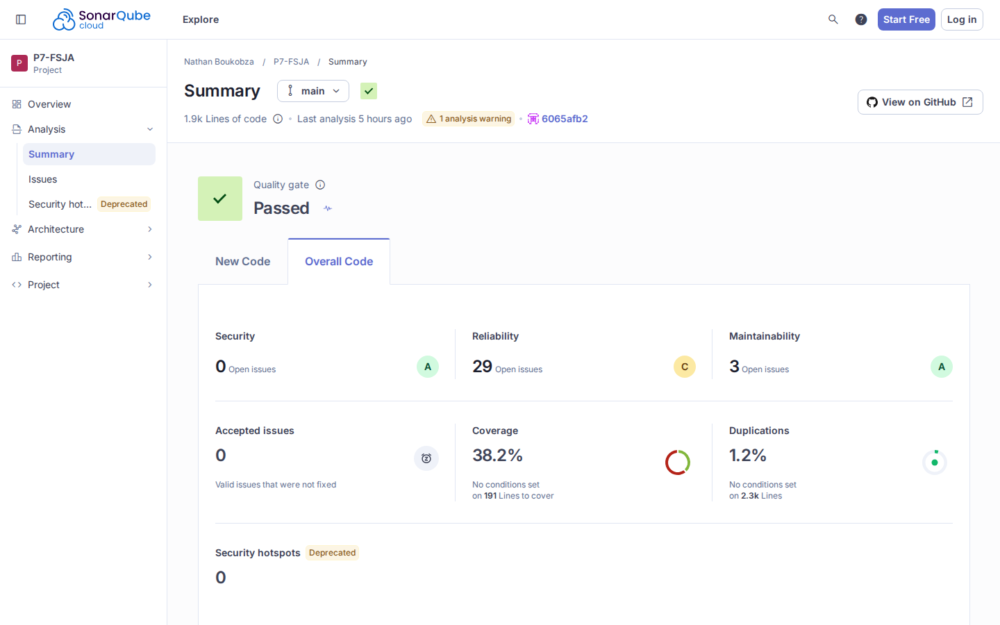
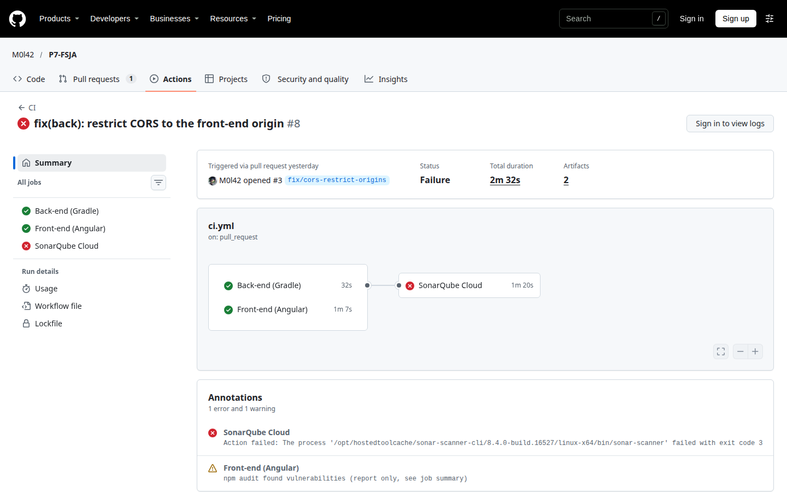
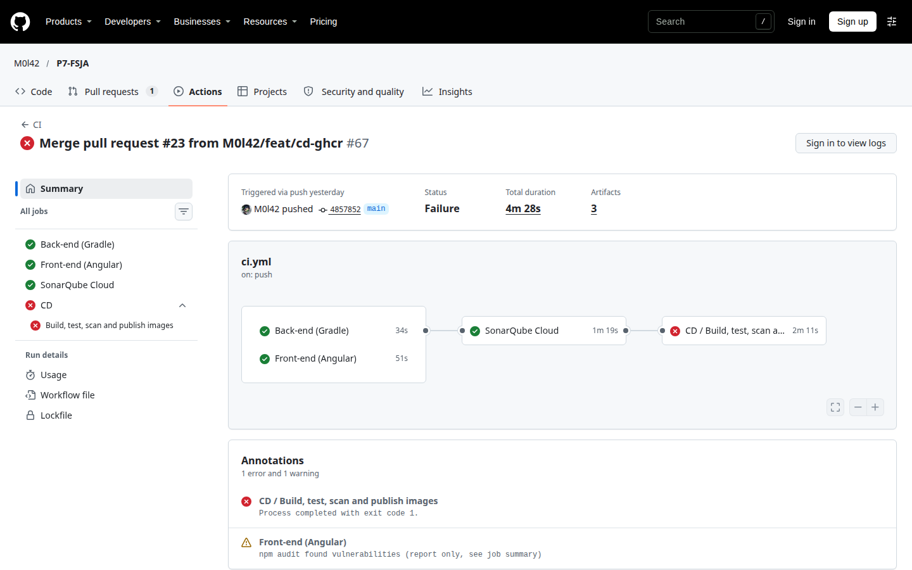
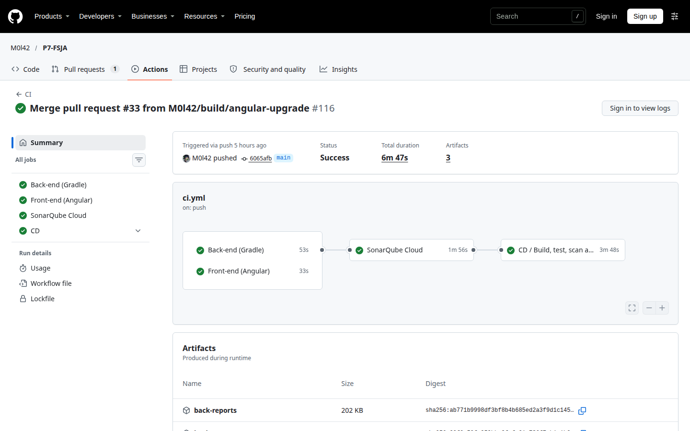
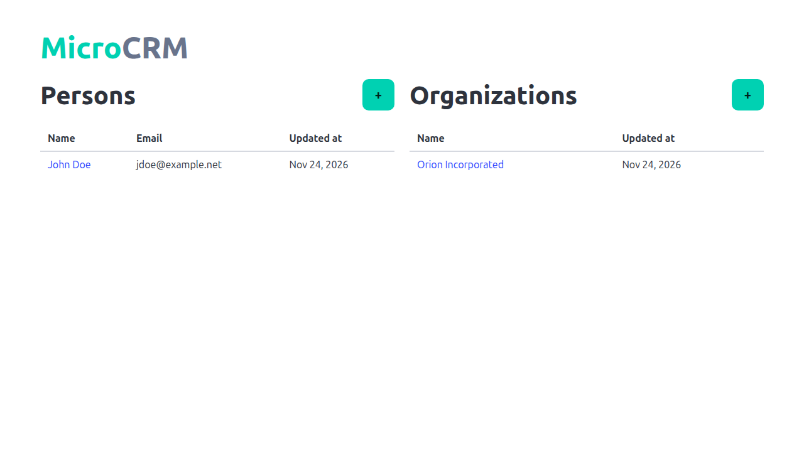

# Documentation technique – MicroCRM

| | |
|---|--|
| **Auteur** | Nathan Boukobza |
| **Option choisie** | Option B (Scénario Orion) |
| **Date** | November 2026 |
| **Dépôt** | https://github.com/M0l42/P7-FSJA |

<!--
- Corps du document : décisions, résultats et justifications. Les preuves détaillées sont en annexes (A à D).
- §6 (monitoring) : à compléter en partie 2 (stack ELK).
- Cible : 10 à 15 pages en PDF, hors annexes.
-->

## 1. Introduction

### Contexte du projet

Orion utilise en interne **MicroCRM**, une application de gestion de la relation client composée :

- d'une **API REST** Spring Boot (dossier `back/`) qui expose les personnes et les organisations via Spring Data REST, avec une base HSQLDB ;
- d'une **application web** Angular (dossier `front/`) qui consomme cette API depuis le navigateur.

La compilation, les tests et le déploiement étaient faits à la main. Ce processus était lent, dépendait de la personne qui le réalisait et laissait passer des erreurs (étape oubliée, version différente d'un poste à l'autre). La direction technique demande une chaîne CI/CD automatisée, avec des contrôles de qualité et de sécurité à chaque étape.

### Objectifs de l'industrialisation

- **Fiabilité** : chaque modification est compilée et testée automatiquement, de la même façon, sur un environnement neutre.
- **Rapidité** : un push suffit pour obtenir un retour (tests, qualité) en quelques minutes ; un tag suffit pour produire une version livrable.
- **Qualité et sécurité** : analyse SonarQube Cloud (bugs, vulnérabilités, couverture), scan des images Docker, aucun secret en clair dans le dépôt.
- **Reproductibilité** : l'application se lance partout avec une seule commande (`make up`).

### Technologies principales

| Outil | Version | Rôle |
|---|---|---|
| Java | 17 | Langage du back-end |
| Spring Boot | 4.2.0 (3.2.5 au départ, §5.3) | Framework de l'API REST (Spring Data REST, JPA) |
| HSQLDB | gérée par Spring Boot | Base de données, stockée sur un volume Docker (§7) |
| Gradle (wrapper) | 8.14.8 (8.7 au départ) | Build, tests et packaging du back-end |
| Node.js | 22 LTS | Build du front-end (CI et image Docker) |
| Angular | 22.3.0 (17.3.8 au départ, §5.3) | Framework du front-end |
| TypeScript | 6.0 | Langage du front-end |
| Karma / Jasmine | 6.4 / 5.1 | Tests unitaires du front-end (Chrome headless) |
| Caddy | image officielle 2.11 | Serveur web du front-end |
| Docker / Docker Compose | 29.1 / 2.40 (poste local) | Conteneurisation et orchestration |
| GitHub Actions | — | Exécution du pipeline CI/CD |
| SonarQube Cloud | — | Analyse de qualité et de sécurité du code |
| Trivy | 0.70 | Scan de vulnérabilités des images Docker |
| GitHub Container Registry | — | Hébergement des images Docker |

Le sujet mentionne Maven ; le projet utilise **Gradle**. Nous conservons Gradle : changer d'outil de build ajouterait un risque sans bénéfice, et Gradle s'intègre aussi bien à GitHub Actions et à SonarQube.

### État initial : analyse locale (étape 1)

Avant toute modification, les builds et les tests existants ont été lancés en local.

| Vérification | Résultat |
|---|---|
| `./gradlew build test` (back) | ✅ 2 tests sur 2 réussis |
| `npm ci` (front) | ✅ mais **90 vulnérabilités** signalées par npm (5 critiques, 51 élevées) |
| `ng test` en Chrome headless (front) | ✅ 8 tests sur 8 ; couverture : 31 % des lignes, 9,5 % des branches |
| `ng build` (front) | ✅ bundle initial de 312 kB |
| Images Docker | ✅ back 373 Mo (seulement après correction de `gradlew`), front 78 Mo |
| Application en conteneurs | ✅ API sur `:8080`, front servi en HTTPS auto-signé |

Points relevés, tous traités dans la suite du projet :

1. **`back/gradlew` n'était pas exécutable dans Git** : `./gradlew` et le build Docker échouaient (« Permission denied »), et les runners GitHub Actions auraient échoué de la même façon. Corrigé (`git update-index --chmod=+x`).
2. **Les conteneurs tournaient en `root`.**
3. **Versions Java incohérentes** : compilation en Java 17, exécution sur un JRE 21.
4. **Frameworks en fin de support** : Angular 17 (qui n'acceptait officiellement que Node 18 et 20, eux-mêmes en fin de vie) et Spring Boot 3.2.
5. **Dépendances npm vulnérables et couverture de tests faible.**
6. **Dockerfile racine unique à cinq cibles** : `alpine:3.19` en fin de vie, `FROM node` sans version, `EXPOSE 4200` sur l'API qui écoute sur 8080.
7. **Base de données en mémoire** : les données étaient perdues à chaque redémarrage (découvert en préparant le plan de sauvegarde, §7).

### Présentation rapide du pipeline CI/CD mis en place

```text
 push / pull request / nightly                         tag vX.Y.Z (posé par une personne)
            │                                                        │
            ▼                                                        ▼
 ┌─────────────────────────────────────────────┐      ┌──────────────────────────────────┐
 │ ci.yml                                      │      │ release.yml                      │
 │  back  : Gradle build, tests, JaCoCo  ─┐    │      │  vérifie le tag (commit sur main)│
 │  front : npm ci, tests, LCOV, build   ─┼─►  │      │  rebuild + tests back et front   │
 │  sonar : SonarQube Cloud + quality gate ◄┘  │      │  appelle cd.yml (images X.Y.Z)   │
 │  deliver (push sur main uniquement) ──────┐ │      │  crée la GitHub Release          │
 └───────────────────────────────────────────┼─┘      └────────────────┬─────────────────┘
                                             ▼                         │
                        ┌──────────────────────────────────────────┐   │
                        │ cd.yml (workflow réutilisable)           │◄──┘
                        │  build → test de fumée → Trivy → GHCR    │
                        └──────────────────────────────────────────┘
```

Le détail de chaque étape est donné au §2 ; la conteneurisation et le déploiement au §3.

## 2. Étapes de mise en œuvre du pipeline CI/CD

### 2.1 Structure du pipeline

**Intégration continue (`ci.yml`).**

| Job | Étapes | Résultat |
|---|---|---|
| `back` | Compilation, tests JUnit, couverture JaCoCo | Rapports HTML (tests, couverture) ; classes compilées et rapport XML pour SonarQube |
| `front` | `npm ci --ignore-scripts`, `npm audit` (non bloquant), tests Karma en Chrome headless avec couverture, `ng build` | Rapport de couverture (HTML, LCOV), résumé de l'audit npm |
| `sonar` | Analyse du code avec les résultats des deux jobs, attente de la *quality gate* | Le job échoue si la *quality gate* échoue |
| `deliver` | Appelle `cd.yml`, **uniquement sur un push sur `main`** | Images publiées sur GHCR |

**Ordre d'exécution.** `back` et `front` sont indépendants et s'exécutent **en parallèle** (environ 1 minute chacun). `sonar` démarre **après les deux**, car il a besoin de leurs classes compilées et de leurs rapports de couverture, transmis sous forme d'artefacts. `deliver` démarre seulement si les trois jobs ont réussi : il travaille donc sur le commit exact validé par la CI. Chaque job écrit un **résumé** sur la page du run (tests réussis ou échoués, couverture, vulnérabilités npm) et publie ses rapports HTML en artefacts pendant 14 jours : les résultats sont lisibles sans ouvrir les logs (annexe D).

**Protection de `main`.** Une règle (*ruleset*) interdit le push direct sur `main` : toute modification passe par une pull request, fusionnable seulement si `back`, `front` et `sonar` sont verts. La *quality gate* est donc réellement bloquante (exemple au §5.1).

**Livraison continue (`cd.yml`).**

| Étape | Détail | En cas d'échec |
|---|---|---|
| Build | `docker compose build`, mêmes Dockerfiles qu'en local, images taguées `sha-<commit>` | Rien n'est publié |
| Test de fumée | `docker compose up -d --wait` (healthchecks verts), puis `curl` : l'API et le front répondent `200`, une origine non autorisée reçoit `403` (CORS) | Logs affichés, rien n'est publié |
| Rapport Trivy | Toutes les sévérités, envoyées dans l'onglet *Security* de GitHub | — (rapport seulement) |
| Porte Trivy | Échec si une vulnérabilité CRITIQUE avec correctif existe dans une image | Rien n'est publié |
| Publication | `docker login` avec le `GITHUB_TOKEN` du job, `docker push` de `sha-<commit>` et `latest` | — |

La publication utilise directement la CLI `docker`, sans action tierce : c'est une dépendance de moins à faire confiance, et ce sont les mêmes commandes qu'en local. Le run nightly et les pull requests ne publient jamais d'image.

**Release (`release.yml`).** Une personne pousse un tag `vX.Y.Z` : c'est l'étape de validation volontaire. Le workflow vérifie que le tag a la forme attendue et que le commit tagué est **sur `main`** (donc déjà validé), relance les tests, appelle `cd.yml` avec la version (images `X.Y.Z`, même test de fumée et même porte Trivy), puis crée la *GitHub Release* avec le JAR, l'archive du build Angular, les empreintes `SHA256SUMS.txt` et les commandes de déploiement. Les releases `v0.1.0` et `v0.2.0` ont été produites ainsi ; `v1.0.0` clôt la partie 1.

**Choix des actions GitHub.** Uniquement des actions maintenues et documentées : les actions officielles de GitHub (`actions/checkout`, `setup-java`, `setup-node`, `upload/download-artifact`) et celles des éditeurs des outils (SonarSource, Aqua Security). Les commandes de build et de test restent celles du projet (`./gradlew`, `npm`), appelées directement : la CI exécute exactement ce qu'un développeur lance en local. Les actions tierces sont épinglées par SHA de commit ; l'annexe A détaille ce choix et l'incident réel qui le justifie.

### 2.2 Scripts d'automatisation

| Commande | Objectif | Où elle est définie | Quand elle s'exécute |
|---|---|---|---|
| `./gradlew build jacocoTestReport` | Compiler le back-end, lancer les tests, produire la couverture | `back/build.gradle` | CI (job `back`), local (`make test-back`) |
| `./gradlew dependencies --write-locks` | Mettre à jour `gradle.lockfile` après un changement de dépendance | `back/build.gradle` (`dependencyLocking`) | Local, lors d'une mise à jour |
| `npm ci --ignore-scripts` | Installer exactement les versions du lock file, sans scripts d'installation | `front/package-lock.json` | CI (job `front`), Docker, local |
| `npm test -- --watch=false --browsers=ChromeHeadlessNoSandbox --code-coverage` | Tests unitaires du front avec couverture | `front/package.json`, `front/karma.conf.js` | CI (job `front`), local (`make test-front`) |
| `npm run build` | Construire l'application Angular | `front/angular.json` | CI, Docker, local |
| `make up` / `make down` / `make logs` / `make ps` | Démarrer, arrêter, suivre l'application | `Makefile` | Local, serveur |
| `make smoke` | Vérifier que l'API et le front répondent | `Makefile` | Local (la CD a son propre test de fumée) |
| `make backup` / `make restore` | Sauvegarder et restaurer les données (§7) | `Makefile` | Serveur, avant chaque mise en production |

Le `Makefile` regroupe les commandes du quotidien (`make help` les liste). La CI n'appelle pas `make` mais les commandes réelles, pour que chaque étape reste visible dans les logs GitHub Actions.

**Adapter le pipeline :** une étape s'ajoute dans le job concerné de `ci.yml` ; le périmètre d'analyse se règle dans `sonar-project.properties` ; les déclencheurs dans la section `on:` de `ci.yml` ; les seuils de qualité dans la *quality gate* de SonarQube Cloud ; les vulnérabilités acceptées dans `.trivyignore` (une justification et une date d'expiration obligatoires).

**Mises à jour automatiques.** Dependabot (`.github/dependabot.yml`) propose chaque semaine des pull requests pour npm, Gradle, les images Docker et les actions GitHub. Elles passent par la même CI que tout autre changement (§8).

### 2.3 Reproductibilité

**Relancer le pipeline :** automatiquement à chaque push, pull request et chaque nuit (03:00 UTC) ; manuellement depuis l'onglet *Actions* → *CI* → *Run workflow* ; ou pour un run précis avec *Re-run jobs*. **En local**, les commandes du §2.2 sont celles de la CI, avec les mêmes versions : Java 17, Node 22, dépendances figées par `package-lock.json` et `gradle.lockfile`. Le lock file npm doit être généré avec la même version de npm que la CI (voir annexe B).

**Gestion des secrets :**
- **un seul secret** : `SONAR_TOKEN`, dans les *GitHub Secrets* du dépôt et dans les *Dependabot secrets* (les pull requests de Dependabot ne reçoivent pas les secrets ordinaires) ;
- il est injecté **uniquement** dans le job `sonar`, et GitHub masque sa valeur dans les logs ;
- la publication sur GHCR utilise le `GITHUB_TOKEN` fourni à chaque job, qui expire avec lui ;
- pour renouveler le jeton : en générer un nouveau dans SonarQube Cloud, puis `gh secret set SONAR_TOKEN` (la valeur est demandée sans être affichée) ;
- les pull requests venant d'un fork ne reçoivent aucun secret : le job `sonar` est alors ignoré et la PR est revue manuellement.

## 3. Plan de conteneurisation et de déploiement

### 3.1 Dockerfiles

**Existant.** Le projet contenait un Dockerfile unique à la racine, avec cinq cibles : `front-build` et `back-build` (compilation), `front` (Caddy installé par `apk` sur Alpine), `back` (JAR sur un JRE 21) et `standalone` (front et back dans **un seul conteneur**, lancés par `supervisord`). Il présentait les défauts listés au §1 : image de base en fin de vie, versions non figées, mauvais port exposé, exécution en `root`.

**Choix retenu : un Dockerfile par composant** (`back/Dockerfile`, `front/Dockerfile`, chacun avec son `.dockerignore`), validé avec le mentor :
- **lisibilité** : chaque fichier ne décrit qu'un composant ;
- **sécurité** : le contexte de build se limite au dossier du composant ;
- **évolutivité** : la partie 2 du projet ajoute des services (Elasticsearch, Kibana) au même `docker-compose.yml` sans restructuration.

Ce remplacement change la façon de déployer (un conteneur `standalone` devient **deux conteneurs**). Il a été traité comme une **migration** : documenté, réalisé en une seule modification, avec retour arrière possible vers une version précédente (§7.3).

**Multi-stage build.** Chaque Dockerfile a une étape de **build** (JDK et Gradle, ou Node et les dépendances) et une étape d'**exécution** qui ne reçoit que le résultat : le JAR, ou les fichiers statiques du front. Les outils de build, le code source et les caches ne sont pas dans l'image finale, qui est plus petite et expose moins de composants vulnérables.

| | Back-end | Front-end |
|---|---|---|
| Étape build | `eclipse-temurin:17-jdk-alpine` + wrapper Gradle → `bootJar` | `node:22-alpine` → `npm ci --ignore-scripts` + `ng build` |
| Étape exécution | `eclipse-temurin:17-jre-alpine` | image officielle `caddy` (Alpine) |
| Port interne | 8080 | 8080 |
| Utilisateur | `app`, non privilégié | `web`, non privilégié |

**Justification des images.**
- **Back-end** : image officielle Temurin, à la même version que la compilation (17), légère. Une image *distroless* réduirait encore la surface d'attaque, mais rendrait le diagnostic difficile (pas de shell) : c'est une évolution à long terme.
- **Front-end, Caddy conservé** : Caddy est le serveur déjà utilisé, et son atout en production est le **HTTPS automatique** (certificat Let's Encrypt obtenu et renouvelé seul). Passer à nginx obligerait à gérer les certificats et à migrer une configuration, tout en changeant deux choses à la fois pendant l'arrivée de la CI/CD. Caddy est donc conservé mais modernisé : image officielle au lieu de `apk add caddy`, utilisateur non privilégié, et adresse du site passée par la variable `SITE_ADDRESS`. En local : HTTP simple sur `:8080`, sans certificat auto-signé ni avertissement du navigateur. En production : le nom de domaine, et Caddy active le HTTPS. La même image sert dans les deux cas.

**Optimisations simples** : versions d'images figées, `.dockerignore`, dépendances installées avant la copie du code source (cache Docker), compression gzip côté Caddy, aucun secret dans les images. Le comparatif avant/après (utilisateur, version Java, tailles) est en annexe C.

### 3.2 docker-compose.yml

| Service | Build | Image publiée | Port hôte → conteneur | Configuration |
|---|---|---|---|---|
| `back` | `./back` | `ghcr.io/m0l42/microcrm-back` | `8080 → 8080` | `APP_CORS_ORIGINS`, base HSQLDB sur le volume `microcrm-data` |
| `front` | `./front` | `ghcr.io/m0l42/microcrm-front` | `4200 → 8080` | `SITE_ADDRESS=:8080` |

Il n'y a pas de service de base de données séparé : HSQLDB est intégrée au processus Java, et ses fichiers sont stockés sur le volume `microcrm-data`, ce qui conserve les données lors des redémarrages et des déploiements (§7). Le port 8080 de l'API est publié, car le front appelle l'API **depuis le navigateur** (`http://localhost:8080`) ; l'origine autorisée par CORS est donc celle du front, `http://localhost:4200`. Chaque service a un **healthcheck** (`make ps` affiche `healthy` ou `unhealthy`).

Chaque service déclare à la fois `build:` et `image:` : le même fichier sert à **construire** l'application en local et à **déployer** une version publiée (§3.3).

```bash
make up      # construit et démarre : application sur http://localhost:4200, API sur http://localhost:8080
make logs    # suit les logs des deux services
make down    # arrête les conteneurs (les données restent sur le volume)
```

### 3.3 Stratégie de déploiement

Orion n'ayant pas de serveur de production accessible dans le cadre de ce projet, le déploiement couvre la **publication des images** sur GitHub Container Registry et une **procédure de mise en production** reproductible avec Docker Compose.

| Déclencheur | Workflow | Tags publiés | Usage |
|---|---|---|---|
| Push sur `main`, une fois la CI verte | `ci.yml` → `cd.yml` | `sha-<commit>` et `latest` | Dernière version validée ; le tag par commit retrouve exactement le code d'une image |
| Tag Git `vX.Y.Z` | `release.yml` → `cd.yml` | `X.Y.Z` | Version livrée, immuable, utilisée en production |

Avant toute publication, les images passent le test de fumée et la porte Trivy ; un échec bloque la publication.

**Mise en production.** Sur le serveur, après une sauvegarde (`make backup`), le même `docker-compose.yml` récupère les images publiées au lieu de les construire :

```bash
TAG=1.0.0 docker compose pull
TAG=1.0.0 docker compose up -d
```

Le retour arrière consiste à relancer ces commandes avec la version précédente. **Évolution prévue** : une fois un serveur disponible, un job ajouté à `release.yml` exécutera cette procédure par SSH (clé et adresse du serveur en *GitHub Secrets*).

**Visibilité.** Le dépôt et les images sont publics pour les besoins du projet de formation. Dans un contexte réel, ils seraient **privés** : le serveur s'authentifierait avant le `pull` (`docker login ghcr.io` avec un jeton en lecture seule), et SonarQube Cloud comme le *code scanning* de GitHub deviendraient payants.

## 4. Plan de testing périodique

Ce plan s'appuie sur les tests existants du projet ; en écrire de nouveaux ne faisait pas partie de la mission. Il y ajoute un **test de fumée** sur les images Docker, et les tests rendus nécessaires par les corrections apportées (CORS).

### 4.1 Types de tests automatisés

| Type | Composant | Contenu | Outil | Étape |
|---|---|---|---|---|
| Intégration | Back-end | `contextLoads` : l'application Spring Boot démarre | JUnit 5 | CI |
| Intégration | Back-end | `PersonRepositoryIntegrationTest` : recherche par e-mail sur une vraie base | JUnit 5, Spring Data | CI |
| Intégration | Back-end | `CorsConfigurationTest` (2 tests) : l'origine du front reçoit l'en-tête CORS, une autre origine ne le reçoit pas | JUnit 5, MockMvc | CI |
| Unitaires | Front-end | 8 tests : 2 services, 4 composants | Karma, Jasmine, Chrome headless | CI |
| Couverture | Back + front | Part du code exécutée par les tests | JaCoCo, Istanbul/LCOV | CI |
| Analyse statique | Back + front | Bugs, vulnérabilités, *code smells*, duplication (§5) | SonarQube Cloud | CI |
| Test de fumée | Images Docker | Les conteneurs démarrent ; l'API et le front répondent `200` ; une origine non autorisée reçoit `403` | Docker Compose, `curl` | CD, release |
| Scan de vulnérabilités | Images Docker | Paquets système et bibliothèques Java du JAR | Trivy | CD, release |

Le test de fumée vérifie ce qu'aucun test unitaire ne voit : que l'image construite démarre réellement, avec la bonne configuration et sur le bon port. L'ancien Dockerfile exposait par exemple le port 4200 pour l'API, qui écoute sur 8080.

### 4.2 Fréquence d'exécution

| Déclencheur | Ce qui s'exécute | Pourquoi |
|---|---|---|
| **Push** sur n'importe quelle branche | CI : build, tests, couverture, SonarQube | Retour rapide, avant même d'ouvrir une pull request |
| **Pull request** vers `main` | CI complète + *quality gate* affichée sur la PR | Rien de cassé ni de non conforme n'est fusionné |
| **Nightly** : chaque jour à 03:00 UTC, sur `main` | CI complète | Détecter ce qui change sans modification du code : nouvelle vulnérabilité publiée, dépendance devenue incompatible |
| **Push sur `main`** | CI puis CD : images, test de fumée, Trivy, publication | Ne publier que des images qui démarrent et sans faille critique corrigeable |
| **Tag `vX.Y.Z`** | Tests complets, CD, puis release | Une version livrée est toujours retestée |

### 4.3 Critères de réussite et d'alerte

Le pipeline **échoue**, et bloque la fusion ou la publication, si : un seul test échoue ; la *quality gate* SonarQube échoue ; le test de fumée n'obtient pas la réponse attendue ; Trivy trouve une vulnérabilité critique corrigeable.

La *quality gate* est celle par défaut de SonarQube Cloud (« Sonar way »). Elle ne juge que le **nouveau code** : au moins 80 % de couverture sur les lignes ajoutées, aucun nouveau bug, aucune nouvelle vulnérabilité, tous les *security hotspots* revus. Ce choix est réaliste au vu de l'état initial (31 % de couverture côté front) : un seuil global ferait échouer la CI dès le premier jour sans rien améliorer, alors qu'avec cette règle chaque modification doit être testée. La couverture globale est suivie comme indicateur, sans bloquer.

**Alertes** : un échec est visible dans l'onglet *Actions* et sur la pull request ; GitHub envoie un e-mail en cas d'échec, y compris pour le run nightly.

### 4.4 Objectifs des tests

- **Qualité** : la *quality gate* empêche l'ajout de code non testé ou présentant des défauts connus.
- **Non-régression** : les tests sont rejoués à chaque push, sur chaque pull request et chaque nuit. Pour les montées de version majeures, une vérification supplémentaire a été faite : comparaison des réponses de l'API et du rendu du front avant et après (annexe B).
- **Vérification avant déploiement** : le test de fumée et Trivy garantissent que les images publiées démarrent, répondent et ne contiennent pas de faille critique corrigeable.
- **Limites** : 12 tests couvrent une petite partie de l'application. Ajouter des tests (contrôleurs REST, scénarios de bout en bout) est la première recommandation pour la suite (§9).

## 5. Plan de sécurité

Ce plan suit un principe simple : **identifier, évaluer, recommander, remonter**. Ce qui est peu coûteux et relève du périmètre est corrigé directement ; le reste est soumis à la direction technique, propriétaire du risque, avec un plan priorisé. Aucun risque n'est « accepté » sans décision explicite, justification et date d'expiration.

**Rôle de SonarQube Cloud.** Il analyse le code Java et TypeScript à chaque exécution de la CI (offre gratuite, le dépôt étant public). Il surveille les **vulnérabilités**, les **security hotspots** (code sensible à revoir manuellement), les **bugs**, les **code smells** (complexité, duplication, mauvaises pratiques) et la **couverture** (rapports JaCoCo et LCOV). La *quality gate* (§4.3) bloque une pull request qui dégrade l'un de ces points.

**Contrôles complémentaires dans le pipeline :**
- **dépendances** : `npm audit` à chaque CI (en rapport, voir §8 pour son passage en bloquant) ; Dependabot ouvre des pull requests de mise à jour et des alertes de sécurité ; les dépendances Gradle sont verrouillées (`gradle.lockfile`) ;
- **images** : Trivy bloque la publication en cas de vulnérabilité critique corrigeable ; images de base officielles et figées ; conteneurs non `root` ;
- **secrets** : un seul secret stocké, *secret scanning* et *push protection* activés (un push contenant un jeton est refusé) ;
- **permissions minimales** : chaque workflow démarre en lecture seule (`contents: read`) et n'ajoute que ce dont un job a besoin (`packages: write`, `contents: write`, `security-events: write`) ;
- **actions GitHub** : actions tierces épinglées par SHA de commit (annexe A).

### 5.1 Résultats SonarQube

| Mesure | Première analyse (22/11/2026) | État actuel (24/11/2026) |
|---|---|---|
| Lignes analysées | 1 412 | 1 891 |
| Vulnérabilités | 6 (note de sécurité **C**) | **0** (note **A**) |
| Security hotspots | 0 | 0 |
| Bugs | 20 (note de fiabilité C) | 20 |
| Code smells | 9 (maintenabilité A, ~40 min de dette) | 9 (A) |
| Couverture globale | 28,4 % | **38,2 %** (lignes 41,9 %, branches 13,8 %) |
| Duplication | 1,6 % | 1,2 % |
| *Quality gate* | — | Passée (annexe D, figure 1) |

**Vulnérabilités identifiées et traitement.**

| Règle | Fichier | Problème | Traitement |
|---|---|---|---|
| `docker:S6505`, `docker:S8543` (×3) | `Dockerfile` racine | `npm ci` sans `--ignore-scripts`, `npx` sans version | **Corrigé** : fichier remplacé (§3.1) |
| `docker:S6471` | `Dockerfile` racine | Image exécutée en `root` | **Corrigé** : utilisateurs non privilégiés |
| `text:S8569` | `back/build.gradle` | Versions de dépendances non verrouillées | **Corrigé** : `gradle.lockfile` |
| `Web:S5725` | `front/src/index.html` | Feuille de style chargée depuis un CDN sans contrôle d'intégrité | **Corrigé** : empreinte SRI `sha384` |

**Bugs et code smells.** Ils concernent le code applicatif du front, hors périmètre du pipeline, et sont transmis à l'équipe de développement : 12 promesses dont les erreurs ne sont jamais traitées (une erreur de l'API passe inaperçue pour l'utilisateur), 7 champs de formulaire sans libellé et un tableau sans en-têtes (accessibilité), un appel asynchrone dans un constructeur (smell critique, `PersonDetailsComponent`).

**Zones de complexité.** La complexité est faible (117 en cyclomatique, 18 en cognitive). Les composants les plus lourds, `person-details` et `organization-details`, sont aussi les moins couverts (27 % et 36 %).

**Couverture.** La première mesure était faussée : les fichiers de test étaient comptés comme du code à couvrir. Après correction de la mesure et ajout des tests CORS, elle passe de 28,4 % à 38,2 %. Elle reste faible sur les services du front.

**Ce que la mise en place a montré :**
- **le pipeline s'est contrôlé lui-même** : la première analyse a signalé 6 vulnérabilités dans le workflow `ci.yml` (scripts npm à l'installation, `npx` sans version, action tierce référencée par tag), corrigées avant la première fusion ;
- **la *quality gate* est réellement bloquante** : la pull request de correction CORS a été bloquée à 25 % de couverture du nouveau code (son fichier de test était encore compté), puis acceptée à 100 % après correction de la mesure (annexe D, figure 2) ;
- **l'analyse automatique ne remplace pas la revue** : SonarQube n'a pas signalé la configuration CORS ouverte à toutes les origines ; elle a été trouvée en relisant le code.

### 5.2 Analyse des risques

L'application manipule des **données personnelles** (noms, e-mails) : le RGPD s'applique. La sévérité tient compte du contexte, une application interne accessible uniquement sur le réseau de l'entreprise.

**Risques applicatifs (OWASP Top 10, 2021)**

| Réf. | Risque constaté | Sévérité | Traitement |
|---|---|---|---|
| A01 – Broken Access Control | L'API n'a **aucune authentification** : quiconque atteint le port 8080 peut lire, modifier et supprimer toutes les données | **Élevée** | Remonté à la direction technique, priorité n°1 |
| A05 – Security Misconfiguration | CORS autorisait **toutes les origines** | Moyenne | **Corrigé** |
| A06 – Vulnerable and Outdated Components | 90 vulnérabilités npm, Angular 17 et Spring Boot 3.2 en fin de support, 9 vulnérabilités critiques dans le JAR | **Élevée** | **Corrigé** : Spring Boot 4.2, Angular 22, 0 vulnérabilité |
| A02 – Cryptographic Failures | L'API est servie en HTTP : les données circulent en clair | Moyenne | HTTPS via Caddy en production |
| A09 – Logging and Monitoring Failures | Pas de journalisation centralisée ni d'alerte | Moyenne | Partie 2 (stack ELK) |
| — (intégrité des données) | Base en mémoire : chaque déploiement effaçait les données | **Élevée** | **Corrigé** : volume persistant et sauvegardes (§7) |

**Risques liés au pipeline**

| Risque | Mesure en place |
|---|---|
| Secret exposé dans le code ou les logs | Un seul secret, masqué dans les logs ; *secret scanning* + *push protection* |
| Jeton aux droits trop larges | `GITHUB_TOKEN` éphémère, permissions minimales par workflow |
| Action GitHub compromise | Actions officielles ou d'éditeurs reconnus, actions tierces épinglées par SHA (annexe A) |
| Image publiée vulnérable ou qui ne démarre pas | Test de fumée et porte Trivy avant publication, seulement après une CI verte |
| Dépendance devenue vulnérable sans changement de code | Run nightly, alertes et mises à jour Dependabot |
| Mise à jour automatique incompatible | Dependabot encadré par des règles ; chaque PR passe la CI (§8) |
| Pull request venant d'un fork | Pas de secrets transmis ; analyse SonarQube ignorée, revue manuelle |

### 5.3 Plan d'action / Remédiation

**Actions réalisées dans ce projet**

- ✅ CORS restreint à l'origine du front (variable `APP_CORS_ORIGINS`), avec tests.
- ✅ Dépendances Gradle verrouillées ; intégrité de la feuille de style du CDN contrôlée (SRI).
- ✅ **Décision SEC01** : le premier run de la CD a été **bloqué par Trivy** (9 vulnérabilités critiques venant de Spring Boot 3.2.5). Correction en deux temps : passage en Spring Boot 3.5 avec Tomcat corrigé, et acceptation formelle, datée et justifiée, de deux vulnérabilités sans correctif gratuit en 6.x (fonctionnalités non utilisées par MicroCRM).
- ✅ **Montée vers Spring Boot 4.2 (SEC02)**, conseillée par le mentor : les deux vulnérabilités acceptées sont corrigées, `.trivyignore` est de nouveau vide.
- ✅ **Montée vers Angular 22 (SEC03)**, une version majeure à la fois : 0 vulnérabilité npm (contre 90).
- ✅ Données persistantes et procédure de sauvegarde testée (§7).
- ✅ Conteneurs non `root`, images officielles figées, Dependabot, *secret scanning*, permissions minimales.
- ✅ Absence d'authentification remontée à la direction technique, avec une condition : **pas d'exposition hors du réseau interne tant que ce point n'est pas traité.**

La démarche suivie pour les montées de version (changements séparés, preuves de non-régression) et les pièges rencontrés sont détaillés en annexe B.

**Court terme**
- Décision de la direction technique sur l'authentification (comptes internes ou SSO, rôles).
- Corriger les 20 bugs relevés par SonarQube dans le front (gestion des erreurs, accessibilité).
- Passer `npm audit` en bloquant pour les vulnérabilités critiques, maintenant que le compteur est à zéro (§8).

**Long terme**
- Authentification (Spring Security + OpenID Connect) côté API et front.
- Servir l'API derrière Caddy en HTTPS, sans exposer directement le port 8080.
- Migrer vers PostgreSQL (sauvegardes à chaud, restauration à un instant précis).
- Étendre l'épinglage par SHA aux actions officielles ; évaluer une image d'exécution *distroless*.

## 6. Monitoring, métriques & KPI

<!-- À compléter en partie 2 (stack ELK). -->

### 6.1 Métriques DORA

> TODO (partie 2) : Lead Time, Deployment Frequency, MTTR, Change Failure Rate (méthode de calcul + valeurs observées).

### 6.2 KPI personnalisés

> TODO (partie 2) : temps de build, temps des tests, taux d'erreurs dans les logs, autre KPI pertinent.

### 6.3 Analyse synthétique du monitoring

> TODO (partie 2) : tendances observées, points forts, points à améliorer, dashboards, alertes.

## 7. Plan de sauvegarde des données

### 7.1 Ce qui doit être sauvegardé

**Constat de départ.** La base HSQLDB fonctionnait **en mémoire**, dans la mémoire vive du processus Java. Le test a été fait : une personne créée par l'API disparaissait après un simple redémarrage du conteneur. Or chaque déploiement recrée le conteneur : **chaque release effaçait les données du CRM**, et la livraison continue rendait ce défaut plus fréquent. Correction apportée, par configuration et sans modifier le code Java : HSQLDB stocke désormais sa base dans des **fichiers** (`jdbc:hsqldb:file:/data/microcrm`) sur un **volume Docker** nommé `microcrm-data` ; les tables sont créées au premier démarrage puis conservées ; les tests automatisés gardent une base en mémoire, isolée.

| Élément | Où il se trouve | Sauvegarde |
|---|---|---|
| **Données du CRM** | Volume Docker `microcrm-data` | `make backup` : archive `backups/microcrm-<date>.tar.gz` |
| **Code, configuration, workflows, documentation** | Dépôt Git sur GitHub | Historique Git ; chaque release est un tag `vX.Y.Z` |
| **Images Docker** | GitHub Container Registry | Une image immuable par version et par commit |
| **Artefacts de build** (JAR, build Angular) | *GitHub Releases* | Attachés à chaque release, avec leurs empreintes SHA-256 |
| **Secret `SONAR_TOKEN`** | *GitHub Secrets* | Non sauvegardé, volontairement : en cas de perte, on en génère un nouveau |

### 7.2 Procédure de sauvegarde

`make backup` arrête l'API quelques secondes (pour copier des fichiers cohérents ; le front reste disponible), archive le contenu du volume dans `backups/microcrm-AAAAMMJJ-HHMMSS.tar.gz`, puis redémarre l'API. Le dossier `backups/` est exclu de Git, car il contient des données personnelles.

- **Format** : archive `tar.gz` des fichiers HSQLDB.
- **Fréquence** : une sauvegarde quotidienne planifiée sur le serveur (`cron`, la nuit), plus une **avant chaque mise en production** ; les 14 dernières archives sont conservées.
- **Stockage** : copier les archives hors du serveur (stockage objet ou autre machine) : une sauvegarde sur le même disque ne protège pas d'une panne de ce disque.

### 7.3 Procédure de restauration

**Scénario 1 : perte ou corruption des données.**
1. Arrêter l'application : `docker compose down`.
2. Si le volume existe encore, le supprimer **volontairement** : `docker volume rm <projet>_microcrm-data`. Cette étape est laissée à une personne, pour qu'un écrasement de données ne soit jamais accidentel.
3. Restaurer : `make restore FILE=backups/microcrm-<date>.tar.gz`. La commande **refuse de s'exécuter si la base n'est pas vide**, puis redémarre l'API.

Procédure testée : création d'une personne, sauvegarde, suppression du volume, restauration ; la personne est bien présente après la restauration.

**Scénario 2 : une nouvelle version pose problème.** On revient à la version précédente, conservée sur GHCR (`TAG=<version précédente> docker compose pull && docker compose up -d`). Les données sont conservées, puisqu'elles sont sur le volume et non dans l'image. Si la nouvelle version avait modifié le schéma de la base, on restaure aussi la sauvegarde faite juste avant la mise en production.

**Limitations** : courte interruption de l'API pendant la sauvegarde ; HSQLDB convient à une application de démonstration, pas à une production avec de nombreux utilisateurs simultanés (cible : PostgreSQL) ; les archives ne sont pas chiffrées et doivent être stockées dans un emplacement à accès restreint (RGPD).

## 8. Plan de mise à jour

### 8.1 Mise à jour de l'application

**Mises à jour mineures et correctifs.** Dependabot ouvre chaque lundi des pull requests groupées (un groupe npm, un groupe Gradle, les images Docker, les actions GitHub). Chacune passe la CI complète ; si tout est vert, elle est fusionnée après une relecture rapide du changelog. Les **alertes de sécurité** de Dependabot génèrent des pull requests immédiates, à traiter en priorité.

**Mises à jour majeures** (Angular, Spring Boot, Gradle, version de Java ou de Node). Dependabot est configuré pour **ne pas les proposer** : sa première exécution a montré pourquoi. Il proposait de passer Angular de 17 à 22 un paquet à la fois, et `zone.js` dans une version incompatible avec Angular 17 ; la CI a bloqué ces pull requests, et des règles ont été ajoutées. Une montée majeure est un **travail planifié**, conduit comme celles de ce projet (annexe B) :
1. une version majeure à la fois, avec les outils de migration officiels (`ng update` pour Angular, guide de migration pour Spring Boot) ;
2. un commit ou une pull request par étape, pour qu'un problème soit attribuable à un seul changement ;
3. une preuve de non-régression **avant / après** : réponses de l'API sur un jeu d'appels de référence, rendu des pages du front, tests et test de fumée ;
4. une release dédiée, avec retour arrière possible vers la version précédente (§7.3).

**Images Docker.** Les images de base sont figées en version et mises à jour par Dependabot (correctifs uniquement : la version de Java doit rester celle de la compilation, et celle de Node compatible avec Angular). Le run nightly et Trivy détectent une image devenue vulnérable.

**Prochaines échéances connues** : Node 22 (fin de support en avril 2027), Spring Boot 4.2 (décembre 2027), Java 17 (la cible de compilation pourra passer en 21 ou 25), Karma, outil de test historique d'Angular, à remplacer par l'outil recommandé par Angular lors d'une prochaine itération.

### 8.2 Mise à jour du pipeline CI/CD

- **Actions GitHub** : Dependabot propose leurs nouvelles versions ; pour les actions épinglées par SHA, il met à jour le SHA et le commentaire de version. Avant de fusionner une mise à jour d'action tierce, vérifier qu'elle correspond à une *release* officielle de l'éditeur (annexe A).
- **Outils** : la version de Trivy est fixée dans `cd.yml` ; celle de Gradle dans le wrapper, avec l'empreinte de la distribution vérifiée ; celle de Node dans `ci.yml`, `release.yml` et `front/Dockerfile`, qui doivent rester alignées.
- **Lock files** : `gradle.lockfile` se régénère avec `./gradlew dependencies --write-locks` ; `package-lock.json` doit être généré avec la version de npm de la CI.
- **Vulnérabilités acceptées** : `.trivyignore` est relu à chaque mise à jour ; chaque entrée a une date d'expiration, après laquelle la porte Trivy bloque de nouveau.
- **Évolution recommandée** : passer `npm audit` en bloquant pour les vulnérabilités critiques, maintenant que le compteur est à zéro, pour qu'il le reste.

### 8.3 Fréquence & bonnes pratiques

| Fréquence | Action |
|---|---|
| Chaque jour | Run nightly : un échec signale une nouvelle vulnérabilité ou une dépendance cassée |
| Chaque semaine | Traiter les pull requests Dependabot (fusion si la CI est verte) |
| Chaque mois | Relire le tableau de bord SonarQube, l'onglet *Security* (rapports Trivy) et `.trivyignore` |
| Chaque trimestre | Vérifier les dates de fin de support des frameworks et des images ; planifier les montées majeures |
| À chaque release | Sauvegarde avant mise en production ; vérification du test de fumée sur le serveur |

Bonnes pratiques : une seule chose à la fois ; jamais de mise à jour sans CI verte ; garder les mêmes versions d'outils en local et en CI ; documenter chaque décision de sécurité avec sa justification et sa date d'expiration ; lire le changelog avant une mise à jour majeure.

## 9. Conclusion

**Améliorations apportées.** MicroCRM est passé d'un processus manuel à une chaîne automatisée complète :
- chaque modification est compilée, testée et analysée par SonarQube, et `main` n'accepte que des changements validés ;
- chaque fusion produit des images Docker testées au démarrage, scannées par Trivy et publiées sur GHCR ;
- un tag produit une release complète : JAR, build Angular, images versionnées et commandes de déploiement.

Le pipeline a aussi servi à corriger l'existant : Spring Boot 3.2 → 4.2, Angular 17 → 22, Gradle 8.7 → 8.14, conteneurs non `root`, CORS restreint, dépendances verrouillées, et données enfin persistantes et sauvegardées.

**Gains observés.**
- **Fiabilité** : vulnérabilités SonarQube de 6 à 0 (note de sécurité C → A), vulnérabilités npm de 90 à 0, zéro vulnérabilité acceptée. Les données ne sont plus perdues au déploiement.
- **Rapidité** : retour complet en 3 à 4 minutes sur une pull request ; publication des images en moins de 10 minutes après une fusion ; une release se déclenche avec une seule commande (`git tag` + `git push`).
- **Qualité** : chaque nouvelle ligne doit être couverte à 80 % ; la couverture globale est passée de 28,4 % à 38,2 %.
- **Sécurité par construction** : le pipeline a bloqué de lui-même plusieurs problèmes réels. Il a signalé ses propres failles de configuration, bloqué une pull request mal couverte, refusé de publier une image contenant 9 vulnérabilités critiques, et détecté une nouvelle vulnérabilité apparue lors d'une montée de version.

**Recommandations pour les itérations suivantes**
1. **Authentification** de l'API et du front : c'est le risque principal restant.
2. **Plus de tests** : contrôleurs REST et scénarios de bout en bout sur l'application déployée.
3. **Corriger les 20 bugs** relevés par SonarQube dans le front.
4. **Déploiement automatique** sur un serveur (job SSH) dès qu'un environnement est disponible, et passage à PostgreSQL.
5. **Monitoring** (partie 2) : stack ELK, métriques DORA et KPI, alertes.

## Annexes

### Annexe A – Choix et sécurité des actions GitHub

| Action | Rôle | Référence |
|---|---|---|
| `actions/checkout`, `actions/setup-java`, `actions/setup-node` | Récupérer le code, installer Java 17 et Node 22 (cache Gradle et npm) | Officielles GitHub, version majeure (`@v7`, `@v6`) |
| `actions/upload-artifact`, `actions/download-artifact` | Transmettre les rapports entre jobs, publier les rapports HTML | Officielles GitHub, version majeure |
| `SonarSource/sonarqube-scan-action` | Analyse SonarQube Cloud | Éditeur, **épinglée par SHA** (v8.5.0) |
| `aquasecurity/trivy-action` | Scan des images | Éditeur, **épinglée par SHA** sur une *release* immuable (v0.36.0), version de Trivy fixée |
| `github/codeql-action/upload-sarif` | Envoyer les rapports Trivy dans l'onglet *Security* | GitHub, **épinglée par SHA** |

**Pourquoi épingler par SHA.** Un tag (`@v8`) peut être déplacé par le propriétaire de l'action, ou par un attaquant qui a volé ses accès ; un SHA de commit ne le peut pas. La première analyse SonarQube a d'ailleurs signalé l'épinglage par tag comme une vulnérabilité (règle `githubactions:S7637`), ce qui a fait évoluer le choix initial.

**Un cas réel.** En mars 2026, les tags de `aquasecurity/trivy-action` ont été détournés : 76 tags sur 77 pointaient vers un code qui volait les secrets des pipelines (avis de sécurité publié par Aqua Security). Les workflows qui référençaient l'action par un tag ont exécuté ce code ; ceux qui l'épinglaient par SHA n'étaient pas touchés. Ce projet épingle donc `trivy-action` sur la version 0.36.0, publiée comme *release* immuable après l'incident.

**Structure de la CD.** Une première version de `cd.yml` se déclenchait à la fin de la CI (`workflow_run`) et récupérait le commit concerné. SonarQube l'a signalée (règle `githubactions:S7631`) : dans certaines configurations, ce schéma peut exécuter du code venu d'un fork avec accès aux secrets. Le filtre « push sur `main` » rendait ce cas impossible ici, mais `cd.yml` est devenu un **workflow réutilisable** appelé par la CI : le risque disparaît à la source, l'enchaînement est plus lisible, et `release.yml` réutilise le même workflow.

### Annexe B – Montées de version et preuves de non-régression

**SEC01 – Publication bloquée par Trivy.** Le premier run de la CD a refusé de publier : 9 vulnérabilités critiques dans le JAR (8 dans Tomcat 10.1.20, dont une exécution de code à distance, 1 dans spring-webmvc 6.1.6), toutes venant de Spring Boot 3.2.5. Aucune branche Spring Boot 3.x n'étant plus maintenue, la décision a été prise en deux temps :
- passage en Spring Boot 3.5.16 avec Tomcat forcé en 10.1.62 : les 8 vulnérabilités Tomcat sont corrigées ;
- deux vulnérabilités de spring-webmvc 6.2 sans correctif gratuit en 6.x (CVE-2026-47884 dans `XsltView`, CVE-2026-47890 dans les Server-Sent Events avec fragments) sont acceptées dans `.trivyignore`, avec justification et expiration au 31/01/2027. MicroCRM n'utilise aucune de ces fonctionnalités, ce qui a été vérifié dans le code. La seconde n'est apparue qu'après la montée en 6.2 : une mise à jour peut aussi introduire une vulnérabilité.

**SEC02 – Spring Boot 4.2,** en deux pull requests séparées :
1. **Gradle 8.7 → 8.14.8** (minimum pour Spring Boot 4), empreinte de la distribution vérifiée. Le lock file a refusé un changement silencieux de version de JaCoCo, accepté ensuite explicitement ;
2. **Spring Boot 3.5.16 → 4.2.0** (Spring Framework 7.1, Tomcat 11, Hibernate 7, Jackson 3). Le code applicatif compile sans modification ; seuls les imports des annotations de test ont changé (modules dédiés en Spring Boot 4). Le forçage de Tomcat et les deux acceptations sont supprimés.

Preuve : les réponses de l'API à **16 appels de référence** (lectures, création, modification, suppression, cas 404, CORS) ont été enregistrées avant, puis rejouées après : **identiques**. Un comportement de l'outil de test a changé : avec Spring Boot 4, MockMvc répond 200 sans en-tête CORS à une requête d'une origine non autorisée, alors que le vrai serveur répond 403. Le test unitaire vérifie désormais la vraie garantie (absence de l'en-tête `Access-Control-Allow-Origin`), et le 403 est vérifié sur le vrai conteneur par le test de fumée de la CD.

**SEC03 – Angular 22,** une version majeure à la fois (17 → 18 → 19 → 20 → 21 → 22), avec à chaque étape les migrations officielles (`ng update`), les tests, le build et un commit séparé. Les migrations ont converti les gabarits vers la nouvelle syntaxe de contrôle (`*ngFor` → `@for`, `*ngIf` → `@if`) et remplacé les modules HTTP dépréciés. Puis `npm audit fix` : **0 vulnérabilité npm**. Preuve : 8 tests sur 8 et couverture identique (30,76 % des lignes) ; le **rendu des 4 routes** (texte visible, 13 champs de formulaire, 14 liens) capturé avant puis comparé sur la nouvelle image Docker : **identique** ; aucune erreur dans la console du navigateur.

**Pièges rencontrés.**
- **Version de npm** : le lock file avait d'abord été généré avec npm 11 (poste local), et npm 10 (CI et Docker) l'a refusé. Il a été régénéré dans l'image `node:22` du pipeline : un outil de build doit être le même en local et en CI.
- **Point d'entrée Angular** : la *quality gate* a bloqué une ligne non couverte dans `main.ts`, qui démarre l'application dans le navigateur et ne peut pas être testé unitairement ; il a été exclu de la mesure de couverture, avec la raison documentée.
- **Limite de débit** : une exécution a échoué parce que Maven Central a limité les requêtes du runner GitHub (HTTP 429), sans lien avec la modification ; la relance a réussi.

### Annexe C – Conteneurs : avant / après

| Contrôle | Ancien Dockerfile racine | Nouveaux Dockerfiles |
|---|---|---|
| Utilisateur dans le conteneur | `root` | `app` (back), `web` (front) |
| Version Java à l'exécution | 21 (compilé en 17) | 17 |
| Taille de l'image back | 373 Mo | 356 Mo |
| Taille de l'image front | 78 Mo | 92 Mo |
| Front servi en | HTTPS auto-signé (avertissement navigateur) | HTTP local, HTTPS automatique en production |
| Données | En mémoire, perdues au redémarrage | Volume persistant, sauvegardes |

L'image du front est un peu plus lourde : l'image officielle `caddy` remplace un paquet `apk`. Ce surcoût est accepté en échange d'une image maintenue par l'éditeur et figée en version.

### Annexe D – Captures

**Figure 1 – Tableau de bord SonarQube Cloud (branche `main`)** : *quality gate* passée, note de sécurité A (0 vulnérabilité), couverture 38,2 %, duplication 1,2 %.



**Figure 2 – Pull request CORS bloquée par la *quality gate*** : les tests passent, mais le job SonarQube échoue (couverture du nouveau code insuffisante), ce qui empêche la fusion.



**Figure 3 – Publication bloquée par Trivy** : CI verte, mais le job CD échoue sur la porte Trivy (9 vulnérabilités critiques) ; aucune image n'est publiée.



**Figure 4 – Pipeline complet sur `main`** : back et front en parallèle, analyse SonarQube, puis CD.



**Figure 5 – Release `v0.2.0`** : commandes de déploiement, images versionnées et changements inclus.


**Figure 6 – Application MicroCRM (Angular 22) servie par le conteneur Caddy.**



<!-- Capture à ajouter (connexion nécessaire) : onglet Security de GitHub avec les rapports Trivy. -->
