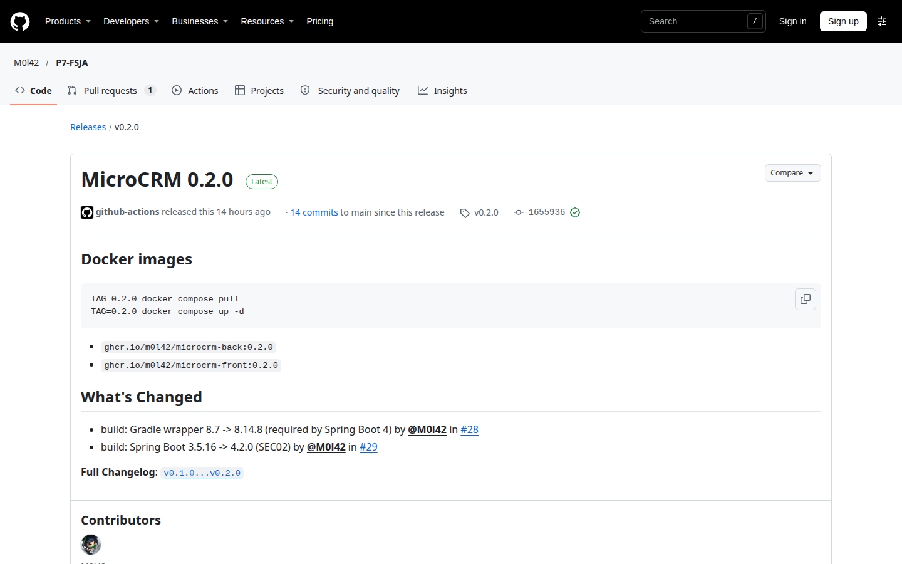
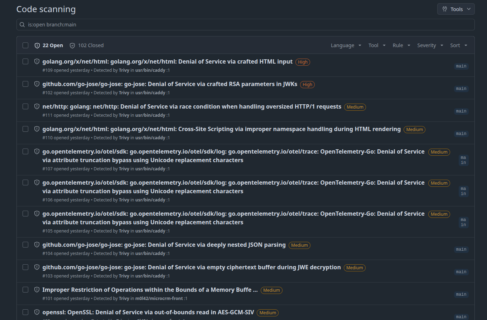
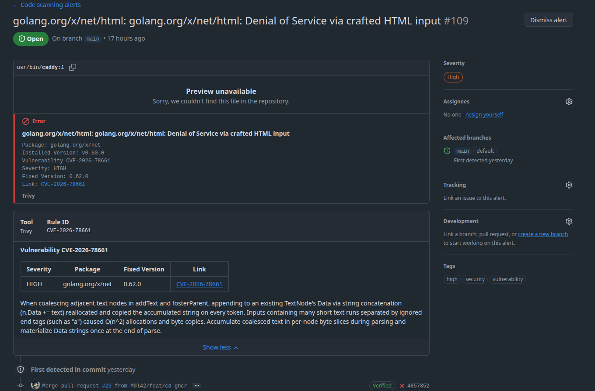
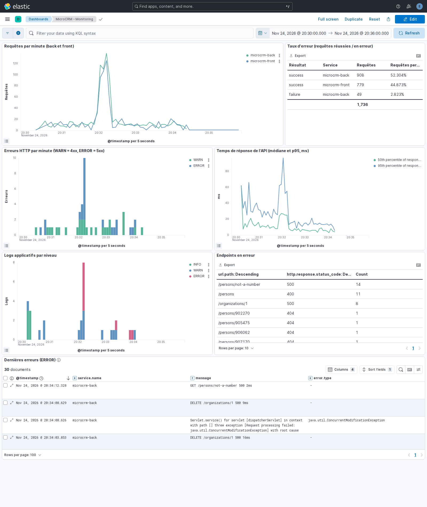

# Documentation technique – MicroCRM

| | |
|---|--|
| **Auteur** | Nathan Boukobza |
| **Option choisie** | Option B (Scénario Orion) |
| **Date** | November 2026 |
| **Dépôt** | https://github.com/M0l42/P7-FSJA |

<!--
- Corps du document : décisions, résultats et justifications. Les preuves détaillées sont en annexes (A à D).
- Cible : 10 à 15 pages en PDF, hors annexes.
-->

## 1. Introduction

### Contexte du projet

Orion utilise en interne **MicroCRM**, une application de gestion de la relation client composée :

- d'une **API REST** Spring Boot (dossier `back/`) qui expose les personnes et les organisations via Spring Data REST, avec une base HSQLDB ;
- d'une **application web** Angular (dossier `front/`) qui consomme cette API depuis le navigateur.

La compilation, les tests et le déploiement étaient faits à la main. Ce processus était lent, dépendait de la personne qui le réalisait et laissait passer des erreurs (étape oubliée, version différente d'un poste à l'autre). La direction technique demande une chaîne CI/CD automatisée, avec des contrôles de qualité et de sécurité à chaque étape.

### Objectifs de l'industrialisation

- **Fiabilité** : chaque modification est compilée et testée automatiquement, de la même façon, sur un environnement neutre.
- **Rapidité** : un push suffit pour obtenir un retour (tests, qualité) en quelques minutes ; un tag suffit pour produire une version livrable.
- **Qualité et sécurité** : analyse SonarQube Cloud (bugs, vulnérabilités, couverture), scan des images Docker, aucun secret en clair dans le dépôt.
- **Reproductibilité** : l'application se lance partout avec une seule commande (`make up`).

### Technologies principales

| Outil | Version | Rôle |
|---|---|---|
| Java | 17 | Langage du back-end |
| Spring Boot | 4.2.0 (3.2.5 au départ, §5.3) | Framework de l'API REST (Spring Data REST, JPA) |
| HSQLDB | gérée par Spring Boot | Base de données, stockée sur un volume Docker (§7) |
| Gradle (wrapper) | 8.14.8 (8.7 au départ) | Build, tests et packaging du back-end |
| Node.js | 24 LTS | Build du front-end (CI et image Docker) |
| Angular | 22.3.0 (17.3.8 au départ, §5.3) | Framework du front-end |
| TypeScript | 6.0 | Langage du front-end |
| Karma / Jasmine | 6.4 / 5.1 | Tests unitaires du front-end (Chrome headless) |
| Caddy | image officielle 2.11 | Serveur web du front-end |
| Docker / Docker Compose | 29.1 / 2.40 (poste local) | Conteneurisation et orchestration |
| GitHub Actions | — | Exécution du pipeline CI/CD |
| SonarQube Cloud | — | Analyse de qualité et de sécurité du code |
| Trivy | 0.70 | Scan de vulnérabilités des images Docker |
| Elasticsearch, Logstash, Kibana, Filebeat | 8.19 | Centralisation et visualisation des logs (monitoring local, §6) |
| GitHub Container Registry | — | Hébergement des images Docker |

Le sujet mentionne Maven ; le projet utilise **Gradle**. Nous conservons Gradle : changer d'outil de build ajouterait un risque sans bénéfice, et Gradle s'intègre aussi bien à GitHub Actions et à SonarQube.

### État initial : analyse locale (étape 1)

Avant toute modification, les builds et les tests existants ont été lancés en local.

| Vérification | Résultat |
|---|---|
| `./gradlew build test` (back) | ✅ 2 tests sur 2 réussis |
| `npm ci` (front) | ✅ mais **90 vulnérabilités** signalées par npm (5 critiques, 51 élevées) |
| `ng test` en Chrome headless (front) | ✅ 8 tests sur 8 ; couverture : 31 % des lignes, 9,5 % des branches |
| `ng build` (front) | ✅ bundle initial de 312 kB |
| Images Docker | ✅ back 373 Mo (seulement après correction de `gradlew`), front 78 Mo |
| Application en conteneurs | ✅ API sur `:8080`, front servi en HTTPS auto-signé |

Points relevés, tous traités dans la suite du projet :

1. **`back/gradlew` n'était pas exécutable dans Git** : `./gradlew` et le build Docker échouaient (« Permission denied »), et les runners GitHub Actions auraient échoué de la même façon. Corrigé (`git update-index --chmod=+x`).
2. **Les conteneurs tournaient en `root`.**
3. **Versions Java incohérentes** : compilation en Java 17, exécution sur un JRE 21.
4. **Frameworks en fin de support** : Angular 17 (qui n'acceptait officiellement que Node 18 et 20, eux-mêmes en fin de vie) et Spring Boot 3.2.
5. **Dépendances npm vulnérables et couverture de tests faible.**
6. **Dockerfile racine unique à cinq cibles** : `alpine:3.19` en fin de vie, `FROM node` sans version, `EXPOSE 4200` sur l'API qui écoute sur 8080.
7. **Base de données en mémoire** : les données étaient perdues à chaque redémarrage (découvert en préparant le plan de sauvegarde, §7).

### Présentation rapide du pipeline CI/CD mis en place

```text
 push / pull request / nightly                         tag vX.Y.Z (posé par une personne)
            │                                                        │
            ▼                                                        ▼
 ┌─────────────────────────────────────────────┐      ┌──────────────────────────────────┐
 │ ci.yml                                      │      │ release.yml                      │
 │  back  : Gradle build, tests, JaCoCo  ─┐    │      │  vérifie le tag (commit sur main)│
 │  front : npm ci, tests, LCOV, build   ─┼─►  │      │  rebuild + tests back et front   │
 │  sonar : SonarQube Cloud + quality gate ◄┘  │      │  appelle cd.yml (images X.Y.Z)   │
 │  deliver (push sur main uniquement) ──────┐ │      │  crée la GitHub Release          │
 └───────────────────────────────────────────┼─┘      └────────────────┬─────────────────┘
                                             ▼                         │
                        ┌──────────────────────────────────────────┐   │
                        │ cd.yml (workflow réutilisable)           │◄──┘
                        │  build → test de fumée → Trivy → GHCR    │
                        └──────────────────────────────────────────┘
```

Le détail de chaque étape est donné au §2 ; la conteneurisation et le déploiement au §3.

## 2. Étapes de mise en œuvre du pipeline CI/CD

### 2.1 Structure du pipeline

**Intégration continue (`ci.yml`).**

| Job | Étapes | Résultat |
|---|---|---|
| `back` | Compilation, tests JUnit, couverture JaCoCo | Rapports HTML (tests, couverture) ; classes compilées et rapport XML pour SonarQube |
| `front` | `npm ci --ignore-scripts`, `npm audit` (non bloquant), tests Karma en Chrome headless avec couverture, `ng build` | Rapport de couverture (HTML, LCOV), résumé de l'audit npm |
| `sonar` | Analyse du code avec les résultats des deux jobs, attente de la *quality gate* | Le job échoue si la *quality gate* échoue |
| `deliver` | Appelle `cd.yml`, **uniquement sur un push sur `main`** | Images publiées sur GHCR |

**Ordre d'exécution.** `back` et `front` sont indépendants et s'exécutent **en parallèle** (environ 1 minute chacun). `sonar` démarre **après les deux**, car il a besoin de leurs classes compilées et de leurs rapports de couverture, transmis sous forme d'artefacts. `deliver` démarre seulement si les trois jobs ont réussi : il travaille donc sur le commit exact validé par la CI. Chaque job écrit un **résumé** sur la page du run (tests réussis ou échoués, couverture, vulnérabilités npm) et publie ses rapports HTML en artefacts pendant 14 jours : les résultats sont lisibles sans ouvrir les logs (annexe D).

**Protection de `main`.** Une règle (*ruleset*) interdit le push direct sur `main` : toute modification passe par une pull request, fusionnable seulement si `back`, `front` et `sonar` sont verts. La *quality gate* est donc réellement bloquante (exemple au §5.1).

**Livraison continue (`cd.yml`).**

| Étape | Détail | En cas d'échec |
|---|---|---|
| Build | `docker compose build`, mêmes Dockerfiles qu'en local, images taguées `sha-<commit>` | Rien n'est publié |
| Test de fumée | `docker compose up -d --wait` (healthchecks verts), puis `curl` : l'API et le front répondent `200`, une origine non autorisée reçoit `403` (CORS) | Logs affichés, rien n'est publié |
| Rapport Trivy | Toutes les sévérités, envoyées dans l'onglet *Security* de GitHub | — (rapport seulement) |
| Porte Trivy | Échec si une vulnérabilité CRITIQUE avec correctif existe dans une image | Rien n'est publié |
| Publication | `docker login` avec le `GITHUB_TOKEN` du job, `docker push` de `sha-<commit>` et `latest` | — |

La publication utilise directement la CLI `docker`, sans action tierce : c'est une dépendance de moins à faire confiance, et ce sont les mêmes commandes qu'en local. Le run nightly et les pull requests ne publient jamais d'image.

**Release (`release.yml`).** Une personne pousse un tag `vX.Y.Z` : c'est l'étape de validation volontaire. Le workflow vérifie que le tag a la forme attendue et que le commit tagué est **sur `main`** (donc déjà validé), relance les tests, appelle `cd.yml` avec la version (images `X.Y.Z`, même test de fumée et même porte Trivy), puis crée la *GitHub Release* avec le JAR, l'archive du build Angular, les empreintes `SHA256SUMS.txt` et les commandes de déploiement. Les releases `v0.1.0` et `v0.2.0` ont été produites ainsi ; `v1.0.0` clôt la partie 1.

**Choix des actions GitHub.** Uniquement des actions maintenues et documentées : les actions officielles de GitHub (`actions/checkout`, `setup-java`, `setup-node`, `upload/download-artifact`) et celles des éditeurs des outils (SonarSource, Aqua Security). Les commandes de build et de test restent celles du projet (`./gradlew`, `npm`), appelées directement : la CI exécute exactement ce qu'un développeur lance en local. Les actions tierces sont épinglées par SHA de commit ; l'annexe A détaille ce choix et l'incident réel qui le justifie.

### 2.2 Scripts d'automatisation

| Commande | Objectif | Où elle est définie | Quand elle s'exécute |
|---|---|---|---|
| `./gradlew build jacocoTestReport` | Compiler le back-end, lancer les tests, produire la couverture | `back/build.gradle` | CI (job `back`), local (`make test-back`) |
| `./gradlew dependencies --write-locks` | Mettre à jour `gradle.lockfile` après un changement de dépendance | `back/build.gradle` (`dependencyLocking`) | Local, lors d'une mise à jour |
| `npm ci --ignore-scripts` | Installer exactement les versions du lock file, sans scripts d'installation | `front/package-lock.json` | CI (job `front`), Docker, local |
| `npm test -- --watch=false --browsers=ChromeHeadlessNoSandbox --code-coverage` | Tests unitaires du front avec couverture | `front/package.json`, `front/karma.conf.js` | CI (job `front`), local (`make test-front`) |
| `npm run build` | Construire l'application Angular | `front/angular.json` | CI, Docker, local |
| `make up` / `make down` / `make logs` / `make ps` | Démarrer, arrêter, suivre l'application | `Makefile` | Local, serveur |
| `make smoke` | Vérifier que l'API et le front répondent | `Makefile` | Local (la CD a son propre test de fumée) |
| `make elk-up` / `make elk-dashboards` / `make elk-down` | Démarrer le monitoring, créer le tableau de bord Kibana, l'arrêter | `docker-compose-elk.yml`, `elk/` | Local, hors CI/CD |
| `make traffic` | Simuler un usage réaliste pour le monitoring | `scripts/traffic.sh` | Local |
| `make dora` | Calculer les métriques DORA et les KPI du pipeline | `scripts/dora.py` | Local, à la demande |
| `make backup` / `make restore` | Sauvegarder et restaurer les données (§7) | `Makefile` | Serveur, avant chaque mise en production |

Le `Makefile` regroupe les commandes du quotidien (`make help` les liste). La CI n'appelle pas `make` mais les commandes réelles, pour que chaque étape reste visible dans les logs GitHub Actions.

**Adapter le pipeline :** une étape s'ajoute dans le job concerné de `ci.yml` ; le périmètre d'analyse se règle dans `sonar-project.properties` ; les déclencheurs dans la section `on:` de `ci.yml` ; les seuils de qualité dans la *quality gate* de SonarQube Cloud ; les vulnérabilités acceptées dans `.trivyignore` (une justification et une date d'expiration obligatoires).

**Mises à jour automatiques.** Dependabot (`.github/dependabot.yml`) propose chaque semaine des pull requests pour npm, Gradle, les images Docker et les actions GitHub. Elles passent par la même CI que tout autre changement (§8).

### 2.3 Reproductibilité

**Relancer le pipeline :** automatiquement à chaque push, pull request et chaque nuit (03:00 UTC) ; manuellement depuis l'onglet *Actions* → *CI* → *Run workflow* ; ou pour un run précis avec *Re-run jobs*. **En local**, les commandes du §2.2 sont celles de la CI, avec les mêmes versions : Java 17, Node 24, dépendances figées par `package-lock.json` et `gradle.lockfile`. Le lock file npm doit être généré avec la même version de npm que la CI (npm 11, Node 24 ; voir annexe B).

**Gestion des secrets :**
- **un seul secret** : `SONAR_TOKEN`, dans les *GitHub Secrets* du dépôt et dans les *Dependabot secrets* (les pull requests de Dependabot ne reçoivent pas les secrets ordinaires) ;
- il est injecté **uniquement** dans le job `sonar`, et GitHub masque sa valeur dans les logs ;
- la publication sur GHCR utilise le `GITHUB_TOKEN` fourni à chaque job, qui expire avec lui ;
- pour renouveler le jeton : en générer un nouveau dans SonarQube Cloud, puis `gh secret set SONAR_TOKEN` (la valeur est demandée sans être affichée) ;
- les pull requests venant d'un fork ne reçoivent aucun secret : le job `sonar` est alors ignoré et la PR est revue manuellement.

## 3. Plan de conteneurisation et de déploiement

### 3.1 Dockerfiles

**Existant.** Le projet contenait un Dockerfile unique à la racine, avec cinq cibles : `front-build` et `back-build` (compilation), `front` (Caddy installé par `apk` sur Alpine), `back` (JAR sur un JRE 21) et `standalone` (front et back dans **un seul conteneur**, lancés par `supervisord`). Il présentait les défauts listés au §1 : image de base en fin de vie, versions non figées, mauvais port exposé, exécution en `root`.

**Choix retenu : un Dockerfile par composant** (`back/Dockerfile`, `front/Dockerfile`, chacun avec son `.dockerignore`), validé avec le mentor :
- **lisibilité** : chaque fichier ne décrit qu'un composant ;
- **sécurité** : le contexte de build se limite au dossier du composant ;
- **évolutivité** : la partie 2 du projet ajoute des services (Elasticsearch, Kibana) au même `docker-compose.yml` sans restructuration.

Ce remplacement change la façon de déployer (un conteneur `standalone` devient **deux conteneurs**). Il a été traité comme une **migration** : documenté, réalisé en une seule modification, avec retour arrière possible vers une version précédente (§7.3).

**Multi-stage build.** Chaque Dockerfile a une étape de **build** (JDK et Gradle, ou Node et les dépendances) et une étape d'**exécution** qui ne reçoit que le résultat : le JAR, ou les fichiers statiques du front. Les outils de build, le code source et les caches ne sont pas dans l'image finale, qui est plus petite et expose moins de composants vulnérables.

| | Back-end | Front-end |
|---|---|---|
| Étape build | `eclipse-temurin:17-jdk-alpine` + wrapper Gradle → `bootJar` | `node:24-alpine` → `npm ci --ignore-scripts` + `ng build` |
| Étape exécution | `eclipse-temurin:17-jre-alpine` | image officielle `caddy` (Alpine) |
| Port interne | 8080 | 8080 |
| Utilisateur | `app`, non privilégié | `web`, non privilégié |

**Justification des images.**
- **Back-end** : image officielle Temurin, à la même version que la compilation (17), légère. Une image *distroless* réduirait encore la surface d'attaque, mais rendrait le diagnostic difficile (pas de shell) : c'est une évolution à long terme.
- **Front-end, Caddy conservé** : Caddy est le serveur déjà utilisé, et son atout en production est le **HTTPS automatique** (certificat Let's Encrypt obtenu et renouvelé seul). Passer à nginx obligerait à gérer les certificats et à migrer une configuration, tout en changeant deux choses à la fois pendant l'arrivée de la CI/CD. Caddy est donc conservé mais modernisé : image officielle au lieu de `apk add caddy`, utilisateur non privilégié, et adresse du site passée par la variable `SITE_ADDRESS`. En local : HTTP simple sur `:8080`, sans certificat auto-signé ni avertissement du navigateur. En production : le nom de domaine, et Caddy active le HTTPS. La même image sert dans les deux cas.

**Optimisations simples** : versions d'images figées, `.dockerignore`, dépendances installées avant la copie du code source (cache Docker), compression gzip côté Caddy, aucun secret dans les images. Le comparatif avant/après (utilisateur, version Java, tailles) est en annexe C.

### 3.2 docker-compose.yml

| Service | Build | Image publiée | Port hôte → conteneur | Configuration |
|---|---|---|---|---|
| `back` | `./back` | `ghcr.io/m0l42/microcrm-back` | `8080 → 8080` | `APP_CORS_ORIGINS`, base HSQLDB sur le volume `microcrm-data` |
| `front` | `./front` | `ghcr.io/m0l42/microcrm-front` | `4200 → 8080` | `SITE_ADDRESS=:8080` |

Il n'y a pas de service de base de données séparé : HSQLDB est intégrée au processus Java, et ses fichiers sont stockés sur le volume `microcrm-data`, ce qui conserve les données lors des redémarrages et des déploiements (§7). Le port 8080 de l'API est publié, car le front appelle l'API **depuis le navigateur** (`http://localhost:8080`) ; l'origine autorisée par CORS est donc celle du front, `http://localhost:4200`. Chaque service a un **healthcheck** (`make ps` affiche `healthy` ou `unhealthy`).

Chaque service déclare à la fois `build:` et `image:` : le même fichier sert à **construire** l'application en local et à **déployer** une version publiée (§3.3).

```bash
make up      # construit et démarre : application sur http://localhost:4200, API sur http://localhost:8080
make logs    # suit les logs des deux services
make down    # arrête les conteneurs (les données restent sur le volume)
```

### 3.3 Plan de déploiement

Orion n'ayant pas de serveur de production dans le cadre de ce projet, le déploiement repose sur les **images publiées** sur GitHub Container Registry et sur une procédure Docker Compose applicable sur n'importe quel serveur.

| Déclencheur | Workflow | Images publiées | Usage |
|---|---|---|---|
| Push sur `main`, CI verte | `ci.yml` → `cd.yml` | `sha-<commit>` et `latest` | Dernière version validée |
| Tag `vX.Y.Z` posé par une personne | `release.yml` → `cd.yml` | `X.Y.Z` | Version livrée en production |

Avant toute publication, les images passent le test de fumée et la porte Trivy (§2.1).

**Prérequis techniques du serveur** : Docker 24 ou plus récent avec Docker Compose v2 ; ports 4200 et 8080 libres (80 et 443 si un nom de domaine est utilisé) ; le fichier `docker-compose.yml` et le `Makefile` du dépôt ; environ 1 Go de mémoire pour l'application. Le monitoring (§6) est optionnel et demande environ 3 Go de plus.

**Procédure de mise en production, dans cet ordre :**
1. `make backup` : sauvegarde des données avant tout changement (§7) ;
2. `TAG=X.Y.Z docker compose pull` : récupération des images de la version ;
3. `TAG=X.Y.Z docker compose up -d` : remplacement des conteneurs ; le volume de données est conservé ;
4. `make ps` puis `make smoke` : les deux services sont `healthy`, l'API et le front répondent ;
5. si le monitoring est utilisé (`make elk-up`) : vérifier dans Kibana que le taux d'erreur et les temps de réponse restent dans les seuils (§6.2).

En cas de problème, la version précédente se redéploie avec la même procédure (`TAG=<version précédente>`).

**Choix justifiés par les mesures** : le test de fumée et la porte Trivy ont bloqué des publications réelles (§5.1) ; le délai de mise en production médian est de quelques dizaines de minutes (§6.1), ce qui permet de publier petit et souvent. Dépôt et images sont publics pour la formation ; dans un contexte réel ils seraient privés et le serveur s'authentifierait avec un jeton en lecture seule.

## 4. Plan de testing périodique

Ce plan s'appuie sur les tests existants du projet ; en écrire de nouveaux ne faisait pas partie de la mission. Il y ajoute un **test de fumée** sur les images Docker, et les tests rendus nécessaires par les corrections apportées (CORS).

### 4.1 Types de tests automatisés

| Type | Composant | Contenu | Outil | Étape |
|---|---|---|---|---|
| Intégration | Back-end | `contextLoads` : l'application Spring Boot démarre | JUnit 5 | CI |
| Intégration | Back-end | `PersonRepositoryIntegrationTest` : recherche par e-mail sur une vraie base | JUnit 5, Spring Data | CI |
| Intégration | Back-end | `CorsConfigurationTest` (2 tests) : l'origine du front reçoit l'en-tête CORS, une autre origine ne le reçoit pas | JUnit 5, MockMvc | CI |
| Intégration | Back-end | `OrganizationDeletionTest` (2 tests) : supprimer une organisation conserve ses membres ; supprimer une personne la retire de ses organisations (ajoutés avec la correction du §5.3) | JUnit 5, MockMvc | CI |
| Unitaires | Front-end | 8 tests : 2 services, 4 composants | Karma, Jasmine, Chrome headless | CI |
| Couverture | Back + front | Part du code exécutée par les tests | JaCoCo, Istanbul/LCOV | CI |
| Analyse statique | Back + front | Bugs, vulnérabilités, *code smells*, duplication (§5) | SonarQube Cloud | CI |
| Test de fumée | Images Docker | Les conteneurs démarrent ; l'API et le front répondent `200` ; une origine non autorisée reçoit `403` | Docker Compose, `curl` | CD, release |
| Scan de vulnérabilités | Images Docker | Paquets système et bibliothèques Java du JAR | Trivy | CD, release |

Le test de fumée vérifie ce qu'aucun test unitaire ne voit : que l'image construite démarre réellement, avec la bonne configuration et sur le bon port. L'ancien Dockerfile exposait par exemple le port 4200 pour l'API, qui écoute sur 8080.

### 4.2 Fréquence d'exécution

| Déclencheur | Ce qui s'exécute | Pourquoi |
|---|---|---|
| **Push** sur n'importe quelle branche | CI : build, tests, couverture, SonarQube | Retour rapide, avant même d'ouvrir une pull request |
| **Pull request** vers `main` | CI complète + *quality gate* affichée sur la PR | Rien de cassé ni de non conforme n'est fusionné |
| **Nightly** : chaque jour à 03:00 UTC, sur `main` | CI complète | Détecter ce qui change sans modification du code : nouvelle vulnérabilité publiée, dépendance devenue incompatible |
| **Push sur `main`** | CI puis CD : images, test de fumée, Trivy, publication | Ne publier que des images qui démarrent et sans faille critique corrigeable |
| **Tag `vX.Y.Z`** | Tests complets, CD, puis release | Une version livrée est toujours retestée |

### 4.3 Critères de réussite et d'alerte

Le pipeline **échoue**, et bloque la fusion ou la publication, si : un seul test échoue ; la *quality gate* SonarQube échoue ; le test de fumée n'obtient pas la réponse attendue ; Trivy trouve une vulnérabilité critique corrigeable.

La *quality gate* est celle par défaut de SonarQube Cloud (« Sonar way »). Elle ne juge que le **nouveau code** : au moins 80 % de couverture sur les lignes ajoutées, aucun nouveau bug, aucune nouvelle vulnérabilité, tous les *security hotspots* revus. Ce choix est réaliste au vu de l'état initial (31 % de couverture côté front) : un seuil global ferait échouer la CI dès le premier jour sans rien améliorer, alors qu'avec cette règle chaque modification doit être testée. La couverture globale est suivie comme indicateur, sans bloquer.

**Alertes** : un échec est visible dans l'onglet *Actions* et sur la pull request ; GitHub envoie un e-mail en cas d'échec, y compris pour le run nightly.

### 4.4 Objectifs des tests

- **Qualité** : la *quality gate* empêche l'ajout de code non testé ou présentant des défauts connus.
- **Non-régression** : les tests sont rejoués à chaque push, sur chaque pull request et chaque nuit. Pour les montées de version majeures, une vérification supplémentaire a été faite : comparaison des réponses de l'API et du rendu du front avant et après (annexe B).
- **Vérification avant déploiement** : le test de fumée et Trivy garantissent que les images publiées démarrent, répondent et ne contiennent pas de faille critique corrigeable.
- **Limites** : 14 tests couvrent une petite partie de l'application. Ajouter des tests (contrôleurs REST, scénarios de bout en bout) est la première recommandation pour la suite (§9).

## 5. Plan de sécurité

Ce plan suit un principe simple : **identifier, évaluer, recommander, remonter**. Ce qui est peu coûteux et relève du périmètre est corrigé directement ; le reste est soumis à la direction technique, propriétaire du risque, avec un plan priorisé. Aucun risque n'est « accepté » sans décision explicite, justification et date d'expiration.

**Rôle de SonarQube Cloud.** Il analyse le code Java et TypeScript à chaque exécution de la CI (offre gratuite, le dépôt étant public). Il surveille les **vulnérabilités**, les **security hotspots** (code sensible à revoir manuellement), les **bugs**, les **code smells** (complexité, duplication, mauvaises pratiques) et la **couverture** (rapports JaCoCo et LCOV). La *quality gate* (§4.3) bloque une pull request qui dégrade l'un de ces points.

**Contrôles complémentaires dans le pipeline :**
- **dépendances** : `npm audit` à chaque CI (en rapport, voir §8 pour son passage en bloquant) ; Dependabot ouvre des pull requests de mise à jour et des alertes de sécurité ; les dépendances Gradle sont verrouillées (`gradle.lockfile`) ;
- **images** : Trivy bloque la publication en cas de vulnérabilité critique corrigeable ; images de base officielles et figées ; conteneurs non `root` ;
- **secrets** : un seul secret stocké, *secret scanning* et *push protection* activés (un push contenant un jeton est refusé) ;
- **permissions minimales** : chaque workflow démarre en lecture seule (`contents: read`) et n'ajoute que ce dont un job a besoin (`packages: write`, `contents: write`, `security-events: write`) ;
- **actions GitHub** : actions tierces épinglées par SHA de commit (annexe A).

### 5.1 Résultats SonarQube

| Mesure | Première analyse (22/11/2026) | État actuel (24/11/2026) |
|---|---|---|
| Lignes analysées | 1 412 | 2 039 |
| **Vulnérabilités** | 6 (note de sécurité **C**) | **0** (note **A**) |
| Security hotspots | 0 | 0 |
| **Bugs** | 20 (note de fiabilité C) | 20 (C) |
| Code smells | 9 (maintenabilité A) | 12 (A, environ 50 min de dette) |
| Couverture | 28,4 % | **38,2 %** (lignes 41,9 %, branches 13,8 %) |
| Duplication | 1,6 % | **1,1 %** |
| Complexité (cyclomatique / cognitive) | 114 / 18 | 113 / 18 |

Les 6 vulnérabilités de départ sont toutes corrigées : quatre dans l'ancien Dockerfile (remplacé), dépendances Gradle non verrouillées (`gradle.lockfile`), feuille de style chargée sans contrôle d'intégrité (empreinte SRI). La duplication est négligeable. La complexité se concentre dans `person-details.component.ts` (21) et `Person.java` (17), qui sont aussi peu couverts (27 % et 45 %). La couverture reste faible sur les services du front (12 à 15 %).

**Alertes prioritaires.** Il ne reste aucune vulnérabilité : les alertes restantes sont des **bugs** (risque de mauvais fonctionnement) et des **code smells** (maintenabilité), qu'il ne faut pas confondre avec des failles. Elles sont classées par impact, en croisant avec ce que le monitoring a observé (§6.3).

| # | Règle | Type | Où | Problème | Lien avec ELK / OWASP 2025 | Priorité |
|---|---|---|---|---|---|---|
| 1 | `typescript:S9383` | Bug | `organization-details.component.ts:58` (suppression) | Promesse sans traitement d'erreur | ELK : 500 sur `DELETE /organizations` ; l'utilisateur ne voyait rien (A10) | **Haute** |
| 2–6 | `typescript:S9383` | Bug | 5 écritures : enregistrement et suppression d'une personne, ajout et retrait d'une organisation, enregistrement d'une organisation | Promesses sans traitement d'erreur | ELK : 400 et 404 renvoyés par l'API, sans retour à l'utilisateur (A10) | **Haute** |
| 7–12 | `typescript:S9383` | Bug | 6 chargements (listes du tableau de bord, fiches, liste des organisations) | Promesses sans traitement d'erreur | Une API indisponible laisserait des pages vides sans message (A10) | Moyenne |
| 13 | `typescript:S7059` | Smell **critique** | `person-details.component.ts:33` | Appel asynchrone dans un constructeur | Comportement difficile à tester (couverture 27 %) | Moyenne |
| 14 | `java:S6813` (×2) | Smell | `InitialDataFixture.java` | Injection par champ au lieu du constructeur | Dépendances implicites, tests plus difficiles | Basse |
| 15 | `Web:InputWithoutLabelCheck`, `Web:S6853`, `Web:S5256` | Bug / smell | 7 champs, 6 libellés, 1 tableau (formulaires) | Accessibilité : champs sans libellé associé, tableau sans en-têtes | Utilisateurs de lecteurs d'écran (RGAA) | Moyenne |

**Ce que SonarQube ne voit pas.** Le monitoring a révélé deux bugs de l'API absents de l'analyse statique : une suppression d'organisation qui supprimait ses membres ou échouait en 500 (corrigé, §5.3), et une erreur 500 au lieu de 400 sur un identifiant mal formé. L'analyse statique et l'observation à l'exécution sont complémentaires.

### 5.2 Analyse des risques

L'application manipule des **données personnelles** (noms, e-mails) : le RGPD s'applique. La sévérité tient compte du contexte, une application interne accessible uniquement sur le réseau de l'entreprise.

**Risques applicatifs (OWASP Top 10 : 2025)**

| Réf. | Risque constaté | Sévérité | Traitement |
|---|---|---|---|
| A01 Broken Access Control / A07 Authentication Failures | L'API n'a **aucune authentification** : quiconque atteint le port 8080 peut lire, modifier et supprimer les données | **Élevée** | Remonté à la direction technique, priorité n°1 |
| A02 Security Misconfiguration | CORS ouvert à toutes les origines | Moyenne | **Corrigé** |
| A03 Software Supply Chain Failures | 90 vulnérabilités npm, 9 critiques dans le JAR, frameworks en fin de support, actions GitHub référencées par tag | **Élevée** | **Corrigé** : montées de version, lock files, SRI, actions épinglées, Dependabot, Trivy |
| A04 Cryptographic Failures | API servie en HTTP : données en clair sur le réseau | Moyenne | HTTPS via Caddy en production |
| A06 Insecure Design | Supprimer une organisation supprimait ses membres (cascade de suppression) | **Élevée** | **Corrigé** (trouvé grâce au monitoring) |
| A09 Security Logging and Alerting Failures | Aucune journalisation centralisée | Moyenne | **Partiellement corrigé** : logs centralisés dans ELK ; alertes à mettre en place |
| A10 Mishandling of Exceptional Conditions | Erreurs non traitées dans le front (12 promesses), 500 au lieu de 400 sur un identifiant mal formé | Moyenne | Plan d'action (§5.3) |

**Risques liés au pipeline**

| Risque | Mesure en place |
|---|---|
| Secret exposé | Un seul secret CI, masqué ; mots de passe ELK dans un `.env` ignoré par Git ; *secret scanning* et *push protection* |
| Jeton aux droits trop larges | `GITHUB_TOKEN` éphémère, permissions minimales ; utilisateur Logstash limité à l'écriture des logs |
| Action GitHub compromise | Actions tierces épinglées par SHA (annexe A) |
| Image vulnérable ou qui ne démarre pas | Test de fumée et porte Trivy avant toute publication |
| Dépendance devenue vulnérable | Run nightly, Dependabot |
| Mise à jour automatique incompatible | Règles Dependabot, CI obligatoire (§8) |
| Données personnelles dans les logs | IP des clients et en-têtes HTTP supprimés par Logstash ; stack ELK limitée à `127.0.0.1` |

### 5.3 Plan d'action / Remédiation

**Réalisé dans ce projet**
- ✅ CORS restreint, dépendances verrouillées, SRI, conteneurs non `root`, images officielles figées, Dependabot, permissions minimales.
- ✅ Publication bloquée par Trivy (9 vulnérabilités critiques) : Spring Boot 3.2 → 4.2, puis Angular 17 → 22 ; aucune vulnérabilité acceptée aujourd'hui (annexe B).
- ✅ Données persistantes et sauvegardes (§7).
- ✅ **Correction issue du monitoring** : supprimer une organisation ne supprime plus ses membres. Le test ajouté reproduisait la perte de données avant correction ; après correction, plus aucune erreur 500 sur `/organizations` dans ELK.
- ✅ Logs centralisés et tableau de bord (§6).
- ✅ Absence d'authentification remontée à la direction technique, avec une condition : pas d'exposition hors du réseau interne.

**Court terme (prochaine itération)**
- Front : traiter les erreurs des 12 promesses et afficher un message à l'utilisateur, en commençant par les 5 écritures (alertes 1 à 6) ; ajouter les tests correspondants.
- API : renvoyer 400 sur un identifiant mal formé (gestionnaire d'exceptions).
- Alertes Kibana : taux d'erreur 5xx et temps de réponse p95 au-delà des seuils du §6.2.
- *Quality gate* plus stricte : ajouter une condition « aucun nouveau bug de fiabilité » et passer `npm audit` en bloquant pour les vulnérabilités critiques.

**Long terme**
- Authentification (Spring Security + OpenID Connect).
- API derrière Caddy en HTTPS ; migration vers PostgreSQL.
- Accessibilité des formulaires (libellés, en-têtes de tableau).

## 6. Monitoring, métriques & KPI

Deux sources de mesure, à ne pas confondre : le **pipeline** (historique GitHub Actions et SonarQube : vitesse et fiabilité des livraisons) et l'**application** (logs centralisés dans ELK : comportement à l'exécution).

**Stack de monitoring.** Un fichier `docker-compose-elk.yml` distinct, hors du pipeline CI/CD (trop lourd), lance Elasticsearch, Logstash, Kibana et Filebeat 8.19 en local (`make elk-up`, environ 3 Go de mémoire). Filebeat lit les logs que Docker écrit déjà pour les conteneurs du back et du front ; Logstash les convertit au format ECS (Elastic Common Schema) ; Elasticsearch les indexe ; Kibana les affiche. Côté application, le back écrit ses logs en JSON ECS et un journal d'accès HTTP (méthode, chemin, statut, durée), le front (Caddy) son journal d'accès en JSON. Sécurité : authentification activée, mots de passe hors du dépôt, ports limités à `127.0.0.1`, utilisateur Logstash limité à l'écriture des logs, adresses IP et en-têtes HTTP supprimés. Le tableau de bord est versionné avec le code (`make elk-dashboards`).

### 6.1 Métriques DORA

Calcul reproductible par `make dora` (`scripts/dora.py`), qui lit l'historique GitHub Actions. Un **déploiement** est une publication réussie des images depuis `main` (ce que le serveur récupère au §3.3). Période : depuis la première exécution de la CD (23/11/2026), avant laquelle rien ne pouvait être déployé.

| Métrique | Méthode de calcul | Valeur mesurée | Repère DORA (niveau « élite ») |
|---|---|---|---|
| **Deployment Frequency** | Publications réussies sur `main` / jours | **7,8 par jour** (14 en 1,8 jour, sur 17 tentatives ; 3 releases) | Plusieurs par jour |
| **Lead Time for Changes** | Premier commit d'une pull request → première publication qui l'inclut | **Médiane 38 min** (6 min à 12,6 h) ; fusion → publication : 6 min | Moins d'un jour |
| **Change Failure Rate** | Exécutions en échec sur `main` / exécutions sur `main` | **18 %** (3 sur 17) | Moins de 15 % |
| **Mean Time to Restore** | Échec sur `main` → exécution réussie suivante | **Médiane 5,9 h** (11 min à 6,1 h, 3 cas) | Moins d'une heure |

**Analyse.** La fréquence de déploiement et le délai de mise en production sont au niveau « élite » : des changements petits, testés en 2 à 3 minutes, publiés automatiquement. Le taux d'échec (18 %) doit être lu avec son contexte : les 3 échecs sont des **publications bloquées par la porte Trivy** (9 vulnérabilités critiques à deux reprises, puis 1), donc des défauts arrêtés avant la production et non des incidents subis par les utilisateurs. Le temps de rétablissement est le point faible : les blocages sont survenus la nuit et ont été corrigés le lendemain, et la décision (montée de Spring Boot) demandait un arbitrage humain. **Recommandations** : notifier immédiatement l'équipe d'un échec sur `main`, maintenir les dépendances à jour en continu (Dependabot) pour éviter les blocages de sécurité, et garder des changements petits. **Limite** : 1,8 jour d'historique et un seul développeur ; ces valeurs sont à suivre dans le temps plutôt qu'à comparer telles quelles.

### 6.2 KPI personnalisés

| KPI | Source | Mesure | Valeur | Objectif | Seuil d'alerte |
|---|---|---|---|---|---|
| **K1 Durée de la CI** | Pipeline | Durée d'une exécution sur pull request (back, front, SonarQube) | Médiane **2,4 min**, max 3,3 min (back 0,6 ; front 0,7 ; SonarQube 1,4) | < 5 min | > 10 min |
| **K2 Qualité** | Pipeline | Taux de réussite de la *quality gate*, couverture, vulnérabilités | **88 %** (43/49), couverture 38,2 %, 0 vulnérabilité | > 90 %, couverture en hausse, 0 vulnérabilité | Gate en échec sur `main`, vulnérabilité > 0 |
| **K3 Taux d'erreur** | Application | Part des requêtes en 4xx et 5xx | Back **5,1 %** (dont 2,3 % de 5xx) ; front 0 % | 5xx < 0,1 % | 5xx > 1 % sur 5 min |
| **K4 Temps de réponse** | Application | Médiane et 95ᵉ percentile de l'API | **14 ms / 54 ms** (p95 ≈ 90 ms pendant le pic) | p95 < 200 ms | p95 > 500 ms sur 5 min |
| **K5 Volume et pics** | Application | Requêtes par minute, logs ERROR et WARN | Médiane **210 req/min**, pic **1 058 req/min** (69 req/s) ; 8 ERROR, 15 WARN | Pas d'ERROR | ERROR > 0 sur 5 min |

K2 est légèrement sous l'objectif (88 %) : les 6 échecs de la *quality gate* sont des blocages justifiés : trois pour une couverture insuffisante du nouveau code (correction CORS, point d'entrée Angular, correction du monitoring) et trois pour un problème de sécurité (schéma `workflow_run` de la première CD, vulnérabilités du script `dora.py` sur deux exécutions), tous corrigés avant fusion. Un taux trop proche de 100 % signalerait au contraire une *quality gate* trop permissive.

Les valeurs K3 à K5 proviennent d'un trafic **simulé** (`make traffic` : 4 minutes, un pic de 20 secondes, environ 5 % d'erreurs volontaires dont deux types d'appels déclenchant des bugs réels). Elles valident la chaîne de mesure et les seuils ; elles seront à recalculer sur un trafic réel.

### 6.3 Analyse synthétique du monitoring

Le tableau de bord Kibana (annexe D, figure 9) affiche le volume de requêtes du back et du front, le taux d'erreur, les erreurs HTTP dans le temps, les temps de réponse (médiane et p95), les logs par niveau, les endpoints en erreur et le détail des dernières erreurs.

**Tendances et points forts.** L'application absorbe le pic (69 req/s) sans erreur supplémentaire : le p95 monte d'environ 25 à 90 ms puis redescend. Le front ne présente aucune erreur et répond en moins de 2 ms.

**Points à améliorer, reliés au code.** Les erreurs 500 se concentrent sur deux endpoints. Le détail des erreurs (`error.type`) a mené directement aux causes :
- `DELETE /organizations/{id}` : `ConcurrentModificationException`, due à une cascade de suppression qui supprimait les membres d'une organisation. **Corrigé** (§5.3) ; après correction, plus aucune 500 sur cet endpoint dans Kibana. Côté front, SonarQube signalait au même endroit une promesse sans traitement d'erreur (alerte 1 du §5.1) : l'utilisateur ne voyait jamais l'échec. Le croisement des deux sources a donné la cause et l'impact.
- `GET /persons/{id}` avec un identifiant mal formé : `ConversionFailedException` et 500 au lieu de 400 (plan d'action §5.3).
- Les logs WARN révèlent une dette technique invisible à l'analyse statique : annotation `@Temporal` dépréciée (Hibernate 7) et `spring.jpa.open-in-view` activé par défaut, à traiter lors des prochaines mises à jour (§8).

**Alertes recommandées** (Kibana, à mettre en place) : taux de 5xx et p95 au-delà des seuils du §6.2, apparition de logs ERROR. **Limites** : stack locale, trafic simulé, pas encore d'alertes ni de conservation longue des logs.

## 7. Plan de sauvegarde des données

### 7.1 Ce qui doit être sauvegardé

Au départ, la base HSQLDB vivait **en mémoire** : une personne créée par l'API disparaissait au redémarrage du conteneur, donc à chaque déploiement. Elle est désormais stockée dans des fichiers sur le **volume Docker `microcrm-data`** (configuration seulement, sans changement de code Java ; les tests gardent une base en mémoire).

| Élément | Où il se trouve | Sauvegarde |
|---|---|---|
| **Données du CRM** (personnes, organisations) | Volume `microcrm-data` | `make backup` |
| **Code, configuration, workflows, documentation** | Dépôt Git (GitHub) | Historique Git, un tag par release |
| **Images Docker** | GitHub Container Registry | Une image immuable par version |
| **Artefacts de build** (JAR, build Angular) | *GitHub Releases* | Attachés à chaque release, avec empreintes SHA-256 |
| **Logs** (monitoring local) | Volume `es-data` d'Elasticsearch | Non sauvegardés : données d'observation, reconstituables |
| **Secrets** (`SONAR_TOKEN`, mots de passe ELK) | *GitHub Secrets*, fichier `.env` local | Non sauvegardés volontairement : on les régénère en cas de perte |

### 7.2 Procédure de sauvegarde

- **Méthode** : `make backup` arrête l'API quelques secondes (fichiers cohérents ; le front reste disponible), archive le volume dans `backups/microcrm-AAAAMMJJ-HHMMSS.tar.gz`, puis redémarre l'API. Le dossier `backups/` est exclu de Git, car il contient des données personnelles.
- **Fréquence** : une sauvegarde par jour, planifiée la nuit sur le serveur (`cron`), et une **avant chaque mise en production** (étape 1 du §3.3). Conserver les 14 dernières archives.
- **Stockage** : copier les archives hors du serveur, dans un emplacement à accès restreint (RGPD).
- **Justification** : avec une fréquence de déploiement de plusieurs fois par jour (§6.1), la sauvegarde avant mise en production est la protection la plus utile ; la sauvegarde quotidienne couvre la perte du serveur.

### 7.3 Procédure de restauration

`make restore FILE=backups/microcrm-<date>.tar.gz` restaure une archive. Par sécurité, la commande **refuse d'écraser une base existante** : remplacer des données reste une action volontaire (`docker compose down` puis suppression du volume par une personne). Procédure testée : création d'une personne, sauvegarde, suppression du volume, restauration ; la personne est retrouvée.

## 8. Plan de mise à jour

### 8.1 Mise à jour de l'application

- **Correctifs et versions mineures** : Dependabot ouvre chaque lundi des pull requests groupées (npm, Gradle, images Docker, actions GitHub). Chacune passe la CI complète (environ 2 minutes, §6.2) puis est fusionnée si tout est vert. Les **alertes de sécurité** Dependabot sont traitées en priorité.
- **Versions majeures** (Angular, Spring Boot, Gradle, Java, Node) : Dependabot est configuré pour **ne pas les proposer**. Sa première exécution proposait Angular 17 → 22 paquet par paquet, et des versions incompatibles : la CI les a bloquées. Une montée majeure est un travail planifié, conduit comme Spring Boot 4 et Angular 22 dans ce projet (annexe B) : une version majeure à la fois avec les outils de migration officiels, un changement par pull request, et une preuve de non-régression avant/après (réponses de l'API, rendu des pages, tests, test de fumée).
- **Images Docker** : versions figées, mises à jour par Dependabot (correctifs seulement : Java doit rester la version de compilation, Node compatible avec Angular). Trivy signale les images devenues vulnérables (§5.1).
- **Justification** : la montée de Spring Boot a fait passer les vulnérabilités critiques du JAR de 9 à 0, celle d'Angular les vulnérabilités npm de 90 à 0 ; le coût d'une mise à jour est faible tant que la CI reste rapide et le taux de réussite de la *quality gate* élevé (§6.2).

### 8.2 Mise à jour du pipeline CI/CD

- **Actions GitHub** : mises à jour par Dependabot ; les actions tierces sont épinglées par SHA de commit (annexe A), à vérifier contre une *release* officielle avant fusion.
- **Outils** : version de Trivy fixée dans `cd.yml`, de Gradle dans le wrapper (empreinte vérifiée), de Node dans `ci.yml`, `release.yml` et `front/Dockerfile` (à garder alignées), de la stack ELK dans `docker-compose-elk.yml` (8.x, mise à jour manuelle, hors CI).
- **Lock files** : `gradle.lockfile` se régénère avec `./gradlew dependencies --write-locks` ; `package-lock.json` doit être écrit par la même version de npm que la CI (npm 11).
- **Vulnérabilités acceptées** : chaque entrée de `.trivyignore` a une justification et une date d'expiration, après laquelle la porte Trivy bloque de nouveau.

### 8.3 Fréquence & bonnes pratiques

| Fréquence | Action |
|---|---|
| Chaque jour | Run nightly : un échec signale une nouvelle vulnérabilité ou une dépendance cassée |
| Chaque semaine | Traiter les pull requests Dependabot |
| Chaque mois | Relire SonarQube, l'onglet *Security* (Trivy), `.trivyignore` et le tableau de bord Kibana |
| Chaque trimestre | Vérifier les fins de support (Node 24 : avril 2028, Spring Boot 4.2 : décembre 2027) et planifier les montées majeures |
| À chaque release | Sauvegarde, puis procédure du §3.3 |

Bonnes pratiques : un seul changement à la fois, jamais de mise à jour sans CI verte, mêmes versions d'outils en local et en CI, et une justification écrite pour chaque exception de sécurité.

## 9. Conclusion

**Améliorations apportées.** MicroCRM est passé d'un processus manuel à une chaîne automatisée et observable :
- chaque modification est compilée, testée et analysée par SonarQube ; `main` n'accepte que des changements validés ;
- chaque fusion produit des images testées au démarrage, scannées par Trivy et publiées ; un tag produit une release complète ;
- les logs du back et du front sont centralisés dans ELK, avec un tableau de bord versionné ;
- les métriques de livraison sont calculées de façon reproductible (`make dora`).

Le pipeline a aussi servi à corriger l'existant : Spring Boot 3.2 → 4.2, Angular 17 → 22, conteneurs non `root`, CORS restreint, dépendances verrouillées, données persistantes et sauvegardées, et un bug de perte de données trouvé grâce au monitoring.

**Gains observés.**
- **Rapidité** : 7,8 déploiements par jour, délai de mise en production médian de 38 minutes, CI de 2,4 minutes par pull request (§6).
- **Fiabilité et sécurité** : vulnérabilités SonarQube 6 → 0 (note C → A), npm 90 → 0, vulnérabilités critiques du JAR 9 → 0, sans exception acceptée. Les 3 échecs sur `main` sont des publications **bloquées avant la production** par Trivy.
- **Qualité** : chaque nouvelle ligne doit être couverte à 80 % ; couverture globale 28,4 % → 38,2 % ; *quality gate* réussie à 88 %, chaque échec correspondant à un défaut réel arrêté avant fusion.
- **Observabilité** : erreurs et performances visibles en temps réel ; le croisement des logs et de SonarQube a mené à une correction concrète.

**Recommandations pour les itérations suivantes** (par ordre de priorité)
1. **Authentification** de l'API et du front : risque principal restant (§5.2).
2. **Traitement des erreurs dans le front** : les 12 promesses signalées par SonarQube, en commençant par les 5 écritures, et le 400 sur un identifiant mal formé (§5.3).
3. **Alertes** Kibana sur les seuils du §6.2 et notification immédiate d'un échec sur `main`, pour réduire le temps de rétablissement (5,9 h aujourd'hui).
4. **Plus de tests** sur les composants les plus complexes et les moins couverts (`person-details`, services du front).
5. **Déploiement automatique** sur un serveur (job SSH) dès qu'un environnement est disponible, puis PostgreSQL et HTTPS de bout en bout.

## Annexes

### Annexe A – Choix et sécurité des actions GitHub

| Action | Rôle | Référence |
|---|---|---|
| `actions/checkout`, `actions/setup-java`, `actions/setup-node` | Récupérer le code, installer Java 17 et Node 24 (cache Gradle et npm) | Officielles GitHub, version majeure (`@v7`, `@v6`) |
| `actions/upload-artifact`, `actions/download-artifact` | Transmettre les rapports entre jobs, publier les rapports HTML | Officielles GitHub, version majeure |
| `SonarSource/sonarqube-scan-action` | Analyse SonarQube Cloud | Éditeur, **épinglée par SHA** (v8.5.0) |
| `aquasecurity/trivy-action` | Scan des images | Éditeur, **épinglée par SHA** sur une *release* immuable (v0.36.0), version de Trivy fixée |
| `github/codeql-action/upload-sarif` | Envoyer les rapports Trivy dans l'onglet *Security* | GitHub, **épinglée par SHA** |

**Pourquoi épingler par SHA.** Un tag (`@v8`) peut être déplacé par le propriétaire de l'action, ou par un attaquant qui a volé ses accès ; un SHA de commit ne le peut pas. La première analyse SonarQube a d'ailleurs signalé l'épinglage par tag comme une vulnérabilité (règle `githubactions:S7637`), ce qui a fait évoluer le choix initial.

**Un cas réel.** En mars 2026, les tags de `aquasecurity/trivy-action` ont été détournés : 76 tags sur 77 pointaient vers un code qui volait les secrets des pipelines (avis de sécurité publié par Aqua Security). Les workflows qui référençaient l'action par un tag ont exécuté ce code ; ceux qui l'épinglaient par SHA n'étaient pas touchés. Ce projet épingle donc `trivy-action` sur la version 0.36.0, publiée comme *release* immuable après l'incident.

**Structure de la CD.** Une première version de `cd.yml` se déclenchait à la fin de la CI (`workflow_run`) et récupérait le commit concerné. SonarQube l'a signalée (règle `githubactions:S7631`) : dans certaines configurations, ce schéma peut exécuter du code venu d'un fork avec accès aux secrets. Le filtre « push sur `main` » rendait ce cas impossible ici, mais `cd.yml` est devenu un **workflow réutilisable** appelé par la CI : le risque disparaît à la source, l'enchaînement est plus lisible, et `release.yml` réutilise le même workflow.

### Annexe B – Montées de version et preuves de non-régression

**SEC01 – Publication bloquée par Trivy.** Le premier run de la CD a refusé de publier : 9 vulnérabilités critiques dans le JAR (8 dans Tomcat 10.1.20, dont une exécution de code à distance, 1 dans spring-webmvc 6.1.6), toutes venant de Spring Boot 3.2.5. Aucune branche Spring Boot 3.x n'étant plus maintenue, la décision a été prise en deux temps :
- passage en Spring Boot 3.5.16 avec Tomcat forcé en 10.1.62 : les 8 vulnérabilités Tomcat sont corrigées ;
- deux vulnérabilités de spring-webmvc 6.2 sans correctif gratuit en 6.x (CVE-2026-47884 dans `XsltView`, CVE-2026-47890 dans les Server-Sent Events avec fragments) sont acceptées dans `.trivyignore`, avec justification et expiration au 31/01/2027. MicroCRM n'utilise aucune de ces fonctionnalités, ce qui a été vérifié dans le code. La seconde n'est apparue qu'après la montée en 6.2 : une mise à jour peut aussi introduire une vulnérabilité.

**SEC02 – Spring Boot 4.2,** en deux pull requests séparées :
1. **Gradle 8.7 → 8.14.8** (minimum pour Spring Boot 4), empreinte de la distribution vérifiée. Le lock file a refusé un changement silencieux de version de JaCoCo, accepté ensuite explicitement ;
2. **Spring Boot 3.5.16 → 4.2.0** (Spring Framework 7.1, Tomcat 11, Hibernate 7, Jackson 3). Le code applicatif compile sans modification ; seuls les imports des annotations de test ont changé (modules dédiés en Spring Boot 4). Le forçage de Tomcat et les deux acceptations sont supprimés.

Preuve : les réponses de l'API à **16 appels de référence** (lectures, création, modification, suppression, cas 404, CORS) ont été enregistrées avant, puis rejouées après : **identiques**. Un comportement de l'outil de test a changé : avec Spring Boot 4, MockMvc répond 200 sans en-tête CORS à une requête d'une origine non autorisée, alors que le vrai serveur répond 403. Le test unitaire vérifie désormais la vraie garantie (absence de l'en-tête `Access-Control-Allow-Origin`), et le 403 est vérifié sur le vrai conteneur par le test de fumée de la CD.

**SEC03 – Angular 22,** une version majeure à la fois (17 → 18 → 19 → 20 → 21 → 22), avec à chaque étape les migrations officielles (`ng update`), les tests, le build et un commit séparé. Les migrations ont converti les gabarits vers la nouvelle syntaxe de contrôle (`*ngFor` → `@for`, `*ngIf` → `@if`) et remplacé les modules HTTP dépréciés. Puis `npm audit fix` : **0 vulnérabilité npm**. Preuve : 8 tests sur 8 et couverture identique (30,76 % des lignes) ; le **rendu des 4 routes** (texte visible, 13 champs de formulaire, 14 liens) capturé avant puis comparé sur la nouvelle image Docker : **identique** ; aucune erreur dans la console du navigateur.

**Ce que les contrôles ont arrêté.** SonarQube a signalé 6 vulnérabilités dans le premier workflow `ci.yml` (scripts npm à l'installation, `npx` sans version, action référencée par tag), puis un schéma risqué dans la première CD (`workflow_run`), et deux vulnérabilités dans le script `dora.py` (argument injecté dans une commande, chemin d'écriture libre) : toutes corrigées avant fusion. La *quality gate* a bloqué une pull request mal couverte, puis la correction du monitoring tant qu'un test manquait. Trivy a refusé trois publications. SonarQube n'a en revanche pas signalé la configuration CORS ouverte, trouvée en relisant le code.

**Correction issue du monitoring.** Les logs montraient des 500 (`ConcurrentModificationException`) sur `DELETE /organizations/{id}`. Cause : la relation organisation–personnes propageait la suppression (`CascadeType.ALL`) ; selon les données, la requête échouait ou **supprimait silencieusement les membres**. Le test ajouté a reproduit la perte de données avant correction. Après correction (plus de suppression en cascade) : 6 tests sur 6, réponses de l'API identiques sur les 16 appels de référence, et plus aucune 500 sur cet endpoint dans Kibana.

**Pièges rencontrés.**
- **Version de npm** : le lock file avait d'abord été généré avec npm 11 (poste local), et npm 10 (Node 22, en CI et dans Docker) l'a refusé. Le problème est revenu avec Dependabot, qui écrit lui aussi le lock file avec npm 11 : chacune de ses mises à jour npm échouait. La correction de fond a été de construire le front avec **Node 24 LTS** (npm 11, supporté jusqu'en avril 2028 et par Angular 22) : la même version de npm est maintenant utilisée sur le poste local, par Dependabot, en CI et dans Docker. Un outil de build doit être le même partout.
- **Point d'entrée Angular** : la *quality gate* a bloqué une ligne non couverte dans `main.ts`, qui démarre l'application dans le navigateur et ne peut pas être testé unitairement ; il a été exclu de la mesure de couverture, avec la raison documentée.
- **Limite de débit** : une exécution a échoué parce que Maven Central a limité les requêtes du runner GitHub (HTTP 429), sans lien avec la modification ; la relance a réussi.

### Annexe C – Conteneurs : avant / après

| Contrôle | Ancien Dockerfile racine | Nouveaux Dockerfiles |
|---|---|---|
| Utilisateur dans le conteneur | `root` | `app` (back), `web` (front) |
| Version Java à l'exécution | 21 (compilé en 17) | 17 |
| Taille de l'image back | 373 Mo | 356 Mo |
| Taille de l'image front | 78 Mo | 92 Mo |
| Front servi en | HTTPS auto-signé (avertissement navigateur) | HTTP local, HTTPS automatique en production |
| Données | En mémoire, perdues au redémarrage | Volume persistant, sauvegardes |

L'image du front est un peu plus lourde : l'image officielle `caddy` remplace un paquet `apk`. Ce surcoût est accepté en échange d'une image maintenue par l'éditeur et figée en version.

### Annexe D – Captures

**Figure 1 – Tableau de bord SonarQube Cloud (branche `main`)** : *quality gate* passée, note de sécurité A (0 vulnérabilité), couverture 38,2 %, duplication 1,2 %.


**Figure 2 – Pull request CORS bloquée par la *quality gate*** : les tests passent, mais le job SonarQube échoue (couverture du nouveau code insuffisante), ce qui empêche la fusion.


**Figure 3 – Publication bloquée par Trivy** : CI verte, mais le job CD échoue sur la porte Trivy (9 vulnérabilités critiques) ; aucune image n'est publiée.


**Figure 4 – Pipeline complet sur `main`** : back et front en parallèle, analyse SonarQube, puis CD.


**Figure 5 – Release `v0.2.0`** : commandes de déploiement, images versionnées et changements inclus.



**Figure 6 – Application MicroCRM (Angular 22) servie par le conteneur Caddy.**


**Figure 7 – Onglet *Security* de GitHub : alertes Trivy sur les images publiées.** Chaque vulnérabilité trouvée dans les images est suivie comme une alerte, avec sa sévérité et le composant concerné.



**Figure 8 – Détail d'une alerte Trivy** : paquet, version installée, version corrigée et référence CVE, ce qui permet de décider de l'action à mener.



**Figure 9 – Tableau de bord Kibana « MicroCRM – Monitoring »** (trafic simulé, 4 minutes) : requêtes par minute avec le pic d'activité, taux d'erreur par service, erreurs HTTP dans le temps, temps de réponse de l'API (médiane et p95), logs applicatifs par niveau, endpoints en erreur et détail des dernières erreurs (`ConcurrentModificationException`), qui a mené à la correction du §5.3.


